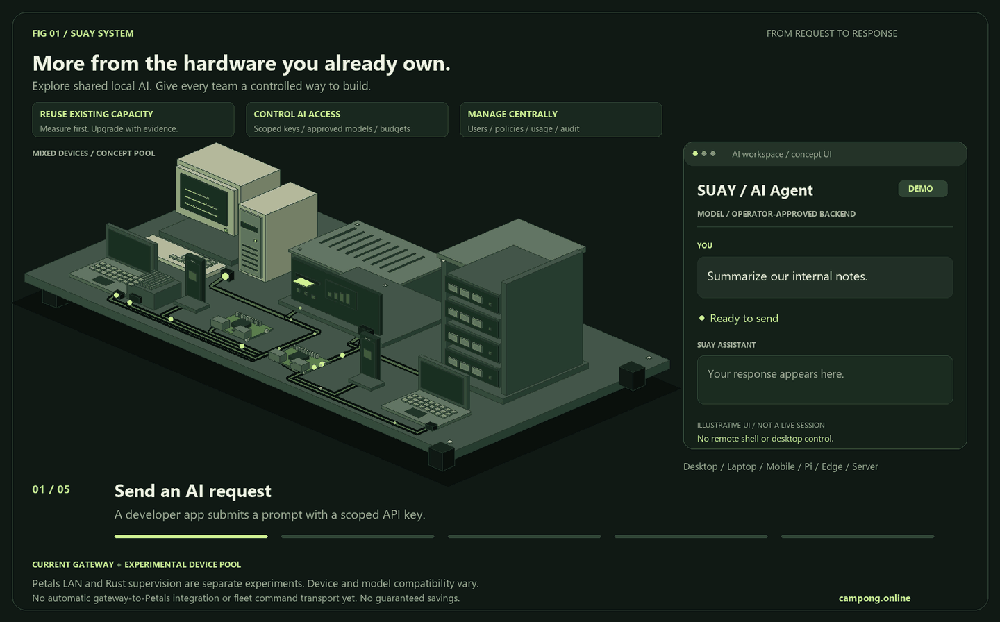

# SUAY


**Wake old machines. Run AI together.**

**ปลุกเครื่องเก่า ให้ร่วมกันรัน AI — เปลี่ยนทรัพยากรที่มี ให้เป็นโอกาสใหม่ขององค์กร**

Distributed AI compute and local resource sharing for organizations with big ambitions and real-world budgets. SUAY explores how existing CPU/GPU capacity can support local inference, developer access and centrally managed AI workloads.

[Website](https://campong.online/projects/suay/) · [ภาษาไทย](https://campong.online/projects/suay/th/) · [Source & community](https://github.com/camponggogo/suay) · [Contributing](CONTRIBUTING.md) · [Security](SECURITY.md) · [MIT license](LICENSE)

[Star SUAY](https://github.com/camponggogo/suay) · [Support development](#support-the-project)


*Concept illustration. It does not claim that all pictured devices currently run the Petals pilot.*

> Early-stage software. The organization control plane and Petals LAN agent are separate pilots. Native service installers, authenticated worker transport and automatic model migration are not implemented. No cost savings, model throughput or production availability are guaranteed.

## Start here — who runs what?

**Read the [step-by-step setup guide in Thai](docs/GETTING_STARTED.th.md) before installing.** It separates machines, environments, startup order, expected results and troubleshooting.

Choose **one path first**:

| Path | Goal | What to run |
|---|---|---|
| **A — Organization gateway** | Users, scoped API keys, model policy, request budgets and forwarding to your own inference backend | One management machine runs `control.app:create_app` with uvicorn, port **8090**. No Petals worker/client is needed. |
| **B — Experimental Petals LAN** | Several supported machines serve model blocks | Every compute machine runs `versions/python/compute/agent/auto_agent.py`. A user machine runs `versions/python/compute/client/app.py`. Agent status is port **8080**. |
| **Rust — optional local supervisor** | Inspect memory/CPU and supervise one locally configured backend | `versions/rust/`; not a coordinator, distributed worker or chat client. |

In **B**, coordinator and worker run **the same agent file**. The lowest active IPv4 is automatically elected coordinator and still serves model blocks. There is no separate `coordinator.py` and no manual `--role` setting. The client reads bootstrap status from an agent and generates through Petals P2P.

In **A**, the management dashboard does **not** run a model itself. You must provide a working inference backend before API requests can return AI output. The A gateway is not connected automatically to the B pool; registering inventory or requesting run/stop does not control those agents yet.

The Petals client is a **terminal prompt application**, not a web chat. The AI Agent window in the GIF is an illustrative UI. The public landing page and its visitor analytics are not required to run either path.

## Why SUAY?

SUAY is an open-source **distributed AI compute and local resource-sharing project** for teams evaluating on-premise LLM inference. It includes a scoped developer API gateway and a separate experimental Petals LAN pool; it does not yet provide a production native-service fleet.

Cloud inference bills grow. New GPUs require budget approval. Internal teams need a controlled way to experiment with AI. SUAY starts with the hardware an organization already has, makes access explicit, and invites the community to measure what works.

Sharing independent inference requests increases capacity differently from splitting one model across machines. The experimental Petals mode shares model blocks; a future native inference pool would route complete requests to capable workers. Neither can turn arbitrary spare RAM into guaranteed LLM performance.

Older hardware is useful only when its supported runtime, memory, energy use and network performance fit the workload. Start with a measured pilot; adding more machines does not automatically make an oversized model fast or economical.

## System overview



[Step-by-step figure and editable assets](docs/SYSTEM_ANATOMY.md) explain the current gateway. Animation timing is illustrative, not a benchmark.


Developers call the inference gateway with scoped API keys. The gateway checks the approved model list and request budget, then forwards to an operator-configured backend. Admins manage users, credentials, inventory and desired state separately. The Petals LAN experiment is not automatically connected to this gateway; native worker commands are not applied yet.

The editable [architecture source and flow notes](docs/ARCHITECTURE.md) are the technical reference. The figure is an explanatory illustration, not proof of deployed worker integration.

Choose [Python Version](https://github.com/camponggogo/suay/tree/main/versions/python) or [Rust Version](https://github.com/camponggogo/suay/tree/main/versions/rust). These have different roles; Rust is not a complete replacement for the Python stack.

## Available now

| Component | Implemented | Limits |
|---|---|---|
| Organization dashboard | Login, forced password change, create/disable users, reset passwords, edit role/zone/node permissions | Local pilot; no SSO/MFA |
| Developer API keys | Create once-visible keys, hashed storage, scopes, expiry, revocation, request budgets, usage counters | Per-key lifetime submission budget; no hard model-token/currency budget |
| Inference gateway | Non-streaming `/v1/chat/completions` to a configured backend with approved models | Operator must provide a working backend; not automatically connected to Petals |
| Resource inventory | Register nodes, filter visibility, store run/stop/drain desired states, audit | Nodes are `not_connected`; commands remain pending, not executed |
| Petals LAN experiment | Discovery, coordinator selection, process supervision, prompt client | Separate unauthenticated LAN prototype; supported hardware/models and full block coverage required |
| Public landing page | Responsive static page, clone command, interactive capacity illustration | Independent from control APIs; illustrative figures are not benchmarks |

## Path A — organization dashboard, no Docker

Use Python 3.10+ in a virtual environment. Clone the repository, run `cd suay`, then run the commands for your OS below. Keep this terminal running. These steps open the dashboard only; an inference backend is a separate prerequisite for AI responses. See [guide A1–A2](docs/GETTING_STARTED.th.md) for the complete sequence.

```powershell
python -m venv .venv-control
.\.venv-control\Scripts\python -m pip install -r versions/python/control/requirements.txt
.\.venv-control\Scripts\python -m uvicorn control.app:create_app --factory --app-dir versions/python --host 127.0.0.1 --port 8090
```

Linux/macOS:

```sh
python3 -m venv .venv-control
.venv-control/bin/python -m pip install -r versions/python/control/requirements.txt
.venv-control/bin/python -m uvicorn control.app:create_app --factory --app-dir versions/python --host 127.0.0.1 --port 8090
```

Open **http://127.0.0.1:8090**. First login is **admin / suay1234**. A password change of at least 12 characters is required before accessing data or creating keys. The password is hashed with PBKDF2-HMAC-SHA256; raw API keys and session secrets are not stored. Password changes invalidate sessions and keys; sign in again afterward.

Set `SUAY_BOOTSTRAP_PASSWORD` before creating the first database to override the public bootstrap password. This variable does not reset an existing account. The SQLite database defaults to `versions/python/control/data/suay.sqlite3` and must never be committed. Back it up securely; configure its file permissions for the service account.

Keep the listener local until HTTPS/reverse proxy and organizational access policies are configured. Set `SUAY_COOKIE_SECURE=1` when serving through HTTPS. The public landing page must never host this dashboard or its database.

### Roles and boundaries

| Role | Access |
|---|---|
| Admin | Users, grants, resets, keys, audit, node inventory and allowlisted AI commands |
| View only | Read assigned zones or nodes |
| Zone display | Read-only zone dashboard; same read API boundary as View only |
| Selected agent monitoring | Read only selected node IDs; zone wildcard does not widen this role |
| AI command line / Developer | Read assigned zones/nodes; run/stop/drain desired states; scoped inference keys |

Empty assignments grant no node visibility. `*` in zones grants all zones for roles other than selected-agent monitoring. The current operator/developer role combines AI commands and inference access; separate these roles before deployments that require stricter organizational separation.

API keys never grant admin user management. User disablement, changed permissions and admin password resets revoke sessions and keys. The AI command API accepts no shell commands, executable paths or arbitrary flags. It records pending desired state only. There is no client file browser, desktop control, remote terminal or power-off command.

### Developer inference access

Start and verify your own OpenAI-compatible backend first. If the gateway is already running, stop it with Ctrl+C. Set these variables in its terminal **before restarting uvicorn** using the command for your OS above. Replace the example model ID and URL with actual values; this configuration does not install a backend:

```powershell
$env:SUAY_MODELS = 'your-approved-model-id'
$env:SUAY_INFERENCE_URL = 'http://127.0.0.1:9000/v1/chat/completions'
# Optional: set SUAY_UPSTREAM_KEY through your secret manager/environment.
```

Non-loopback upstreams require HTTPS. The upstream URL and approved model list are administrator deployment configuration, not developer request parameters. The public API key is not forwarded upstream. Upstream failures are sanitized. Model approval and license review are the operator's responsibility.

Create a key in the dashboard with `inference` scope, expiration and maximum requests. Save it when shown; it is not retrievable later. Example (shell syntax):

```sh
curl http://127.0.0.1:8090/v1/chat/completions \
  -H "Authorization: Bearer $SUAY_API_KEY" \
  -H 'X-SUAY-Request: 1' \
  -H 'Content-Type: application/json' \
  -d '{"model":"your-approved-model-id","messages":[{"role":"user","content":"Hello, SUAY"}],"max_tokens":128}'
```

Scopes: `observe`, `command`, `inference`. Expiration is checked on every request. Inference budgets are checked atomically in SQLite and count accepted submissions, including backend failures. Reported `usage.total_tokens` is tracked separately and depends on backend reporting. Streaming, billing, per-team token budgets and automatic monthly resets are not implemented. Each key is restricted to the approved global model catalog; per-key model catalogs and zone-based inference routing remain future work. Node grants currently restrict inventory/commands, not inference model access.

## Quick start — public landing page only

```sh
python -m http.server 8070 --bind 127.0.0.1 --directory landing
```

Open **http://127.0.0.1:8070**. This is a separate static site with no control-plane dependency and no login. Sliders illustrate allocated CPU share, not LLM speed or combined GPU memory. All asset references are relative. Google Fonts are optional external requests; system-font fallbacks work offline.

The public landing page is deployed at **https://campong.online/projects/suay/**, using the existing host Nginx and no Docker. See [deploy/README.md](deploy/README.md) for preflight, deployment, backups and rollback. `deploy/.env` is private local configuration and is ignored by Git. The host configured in the supplied deployment files uses **campong.online**, not `compong.online`.

## Path B — experimental Petals LAN

Use the [machine-by-machine guide, B1–B6](docs/GETTING_STARTED.th.md). It includes native Linux commands with separate Python 3.10 environments. Docker files and launchers under the compute directories are legacy alternatives; they are not required by that guide.

1. On each compute machine, install `versions/python/compute/agent/requirements.txt` in its own Petals environment.
2. Start `versions/python/compute/agent/auto_agent.py` on the first machine; wait for discovery, DHT and Petals startup.
3. Run the **same agent command** on additional compute machines, with each machine's own `NODE_IP` and the same model/broadcast settings. Coordinator election is automatic.
4. Check an agent's `http://AGENT_IP:8080/api/status`. Nonempty peers and running processes are not proof of full model coverage.
5. On the user machine, install `versions/python/compute/client/requirements.txt` in a separate client environment, then run `app.py --coordinator http://AGENT_IP:8080`. Wait for the terminal prompt before typing.

Petals is pinned to 2.3.0; transitive dependencies and hardware compatibility still require validation. This is not a release of native workers for every OS. Do not combine this environment with the Path A environment.

Agent configuration: `MODEL_NAME` (default `bigscience/bloom-560m`), `NUM_BLOCKS` (default 2), `PETALS_DEVICE` (default cpu), `NODE_IP`, `BROADCAST_ADDRESS`, `DISCOVERY_PORT` (31338), `DASHBOARD_PORT` (8080). Allow TCP 31337/31339, UDP 31338 and TCP 8080 only within the trusted pilot network. The model must have complete block coverage across healthy workers. The default BLOOM-560m model has 24 layers; a one-machine experiment requires an appropriate block allocation and enough memory. It is a small base model, not an instruction-tuned enterprise assistant.

The old agent API has no organization authentication. The new tokens do **not** secure its UDP/P2P traffic or the old Client. Do not expose either to the Internet. Network partition recovery, in-flight request survival and public multi-tenant compute are not guaranteed.

## Native service roadmap

[Detailed architecture in Thai](docs/NATIVE_SERVICES_PROPOSAL.th.md): Windows SCM service, Linux systemd, macOS launchd, low-privilege runtime, authenticated outbound worker transport, lease expiry, signed model catalog, safe rollout/rollback and acknowledged states. These are planned, not delivered installers.

Android starts as a gateway client. Android background/foreground-service rules do not permit a general promise of invisible, unstoppable compute. Enterprise management is separate from the AI API.

## Development and tests

```sh
python -m pip install -r versions/python/control/requirements.txt -r versions/python/visitor_analytics/requirements.txt
python -m unittest discover -s tests -v
python -m compileall -q versions/python deploy
node --check versions/python/control/static/app.js
node --check landing/main.js
```

Tests cover election expiry, client status retrieval, forced password changes, permission filtering, shell rejection, API key scopes/revocation/expiry, resets, CSRF boundaries, login throttling and mocked inference accounting. Mocked inference tests do not validate a real model backend, GPU, Petals coverage or native OS services.

## Contribute to the next step

Clone, reproduce a workload, and share measurements:

```sh
git clone https://github.com/camponggogo/suay.git
cd suay
```

The source is maintained at [camponggogo/suay](https://github.com/camponggogo/suay). Read [CONTRIBUTING.md](CONTRIBUTING.md), [SECURITY.md](SECURITY.md) and [GitHub launch guidance](docs/GITHUB_LAUNCH.md). Useful first contributions: native packaging, worker authentication, safe model placement, hardware benchmarks, reproducible dependencies and organization-specific usage policies.

## Support the project

Questions about hardware support, licensing or API access? Read the [English FAQ](https://campong.online/projects/suay/#faq) or [คำถามภาษาไทย](https://campong.online/projects/suay/th/#faq). Website indexing and measurement are documented in [SEARCH_DISCOVERY.md](docs/SEARCH_DISCOVERY.md).

If SUAY helps your work, [star the repository](https://github.com/camponggogo/suay). It helps other teams discover the project. Reproducible issues, hardware measurements and focused pull requests are equally useful.

Want to buy the maintainer a coffee? **GitHub Sponsors is the intended support channel; setup is pending.** A working sponsorship link will be added once the maintainer's Sponsors page is active. Donations are optional and do not unlock features or imply a support contract.

## License

Original SUAY code: **MIT**, free to use, modify and redistribute subject to the license notice. Petals is separately MIT licensed. BLOOM weights use **BigScience RAIL**, with use restrictions and redistribution/hosted-access obligations; they are not covered by SUAY's MIT license. Other models and dependencies retain their own terms. No model weights are bundled. See [THIRD_PARTY_NOTICES.md](THIRD_PARTY_NOTICES.md) for reviewed sources and remaining dependency audit work.
