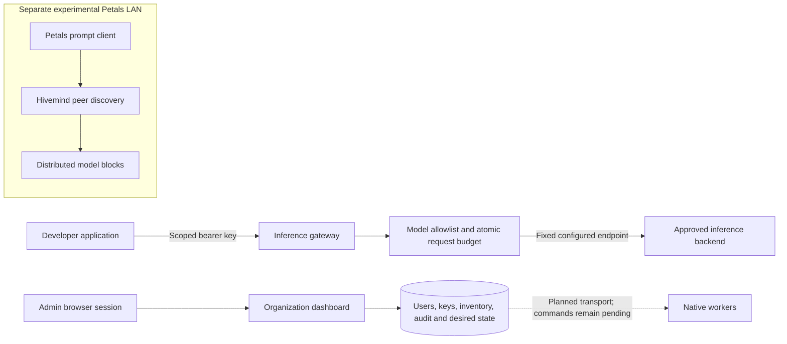

# Architecture

SUAY currently contains two independent experiments: an organization control plane with an inference proxy, and a Petals LAN compute pilot. Native service deployment and authenticated worker reconciliation are planned.

## Implemented request flow

Solid connections show existing pilot behavior. The dashed edge is a proposed integration and does not execute worker commands. The organization API does not currently route inference into the separate Petals client.

## Security boundaries

- Browser sessions manage users and keys. API keys do not grant account administration.
- Node visibility and desired-state writes are filtered by assigned zones or selected node IDs. These assignments do not implement per-zone inference routing.
- Inference keys are hashed at rest, expire, and can be revoked. Request quotas count accepted submissions, not a hard model-token or currency budget.
- The inference upstream is operator configuration. Callers cannot choose arbitrary URLs, executable paths, shell commands or runtime flags.
- The Petals pilot's original UDP/P2P traffic is separate and unauthenticated; control-plane login does not secure it.

## Figures and maintenance

The device-network illustration is a conceptual visual. Phones and edge boards in it express the project's direction, not a compatibility certification. The architecture image was composed with ChatGPT ImageGen, reviewed against the current code, and is accompanied by the editable flow above. Keep this source and the README synchronized when worker transport or native services are implemented.
