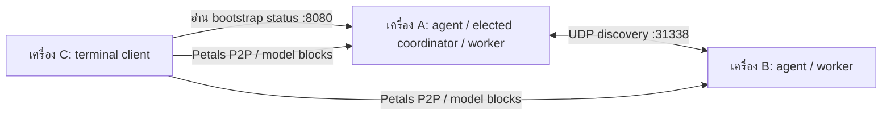

# เริ่มใช้ SUAY: เครื่องไหนต้องรันอะไร

**เลือกทำ A หรือ B ก่อน อย่ารันทุกอย่างพร้อมกัน** โค้ดปัจจุบันมีสอง pilot ที่แยกกันอยู่ ยังไม่มีระบบติดตั้งครั้งเดียวแล้วเชื่อม coordinator, worker และหน้าแชตครบวงจร

| อยากลองอะไร | เลือก | สิ่งที่ได้ |
|---|---|---|
| บัญชีผู้ใช้, API key, สิทธิ์, โควตาคำขอ และ gateway | A | เว็บผู้ดูแลพอร์ต 8090; จะตอบ AI ได้ต้องมี inference backend ของคุณเอง |
| ให้หลายเครื่องช่วยรัน model blocks ด้วย Petals | B | ทุกเครื่องรัน agent; เลือก coordinator อัตโนมัติ; ถาม AI ผ่าน terminal client |
| ดู RAM/CPU และควบคุม process ในเครื่องด้วย Rust | ส่วน Rust ท้ายคู่มือ | ตัวดูแล process ในเครื่อง ไม่ใช่ coordinator หรือ Petals worker |
| เปิดเว็บประชาสัมพันธ์ | ไม่ต้องใช้ใน A/B | `landing/` เป็นเว็บแนะนำโครงการ ไม่ใช่หน้าแชตหรือระบบจัดการเครื่อง |

## ใครเป็นใคร

| บทบาท | อยู่เครื่องไหน / รันอะไร | ทำงานแค่ไหน |
|---|---|---|
| ผู้ดูแล A | เครื่องที่เลือก 1 เครื่อง รัน `versions/python/control/app.py` ผ่าน uvicorn | บัญชี, key, policy และส่งคำขอไป backend; ไม่มีโมเดล AI ติดมา |
| Inference backend ของ A | เครื่องเดียวกับ gateway หรือ endpoint HTTPS ที่ผู้ดูแลอนุมัติ | รันโมเดลจริง; ต้องเตรียมแยกเอง SUAY ไม่ได้ติดตั้งให้ |
| Coordinator ของ B | agent ที่มี IPv4 ต่ำสุดในกลุ่มที่ยังส่ง heartbeat | เป็นบทบาทที่เลือกอัตโนมัติ ไม่ใช่โปรแกรมอีกตัว; เครื่องนี้เป็น worker ด้วย |
| Worker ของ B | ทุกเครื่องที่แบ่ง compute รัน `versions/python/compute/agent/auto_agent.py` | เปิด DHT และ process Petals เพื่อให้บริการ model blocks |
| Client ของ B | เครื่องผู้ใช้ รัน `versions/python/compute/client/app.py` | รับ prompt ใน terminal แล้วใช้ Petals; ต้องติดตั้ง dependencies และดาวน์โหลดส่วนประกอบโมเดลด้วย ไม่ใช่ browser บาง ๆ |
| ผู้ใช้ A | ใช้ browser หรือแอปที่เรียก API | เปิด dashboard เพื่อจัดการ หรือเรียก gateway ด้วย API key ไม่ต้องรัน Petals client |

**`control/app.py` ไม่ได้เป็น coordinator ของ Petals** และ `compute/client/app.py` ไม่ได้เรียก gateway พอร์ต 8090 การเห็น node ใน dashboard A ยังไม่ได้แปลว่า worker B เชื่อมต่อเข้ามาแล้ว คำสั่ง run/stop/drain ใน A ยังเป็น pending desired state

## ก่อนเริ่มทั้งสองทาง

ติดตั้ง Git และ Python ให้ตรงกับทางที่จะลอง เปิด terminal แล้ว clone หนึ่งครั้งต่อเครื่อง:

```sh
git clone https://github.com/camponggogo/suay.git
cd suay
```

คำสั่งต่อจากนี้ให้รันจากโฟลเดอร์ **suay ที่มี README.md นี้** ไม่ต้อง `cd` เข้าโฟลเดอร์ย่อย เว้นแต่คู่มือระบุ เครื่องที่ clone ไว้แล้วให้เปิด terminal ที่ repository เดิม

แต่ละ code block เป็นคำสั่งต่อเนื่อง อย่าคัดลอกทั้ง PowerShell และ Linux มารันรวมกัน ค่า IP และชื่อโมเดลที่ยกตัวอย่างต้องเปลี่ยนให้ตรงกับเครื่องจริง

## A — ลอง dashboard/gateway บนเครื่องเดียวก่อน

เริ่มทางนี้หากต้องการทำความเข้าใจบัญชีและสิทธิ์ **ไม่ต้องเปิด worker หรือ Petals client และยังไม่ต้องใช้ Rust** Python 3.10+; CI ตรวจ source ด้วย Python 3.11

### A1. ติดตั้งและเปิดเว็บผู้ดูแล

Windows PowerShell:

```powershell
python -m venv .venv-control
.\.venv-control\Scripts\python.exe -m pip install -r versions/python/control/requirements.txt
.\.venv-control\Scripts\python.exe -m uvicorn control.app:create_app --factory --app-dir versions/python --host 127.0.0.1 --port 8090
```

Linux/macOS:

```sh
python3 -m venv .venv-control
.venv-control/bin/python -m pip install -r versions/python/control/requirements.txt
.venv-control/bin/python -m uvicorn control.app:create_app --factory --app-dir versions/python --host 127.0.0.1 --port 8090
```

ปล่อย terminal นี้ทำงานไว้ เปิด browser **บนเครื่องเดียวกัน** ไปที่ <http://127.0.0.1:8090> เข้าครั้งแรกด้วย `admin / suay1234` แล้วเปลี่ยนรหัสผ่านตามหน้าจอ ถ้ามีฐานข้อมูลเดิมอยู่แล้วให้ใช้รหัสผ่านที่เคยตั้ง ไม่ใช่รหัสเริ่มต้น

สำเร็จขั้นนี้ = เปิด dashboard และจัดการบัญชีได้ **ยังไม่ได้แปลว่ารัน AI ได้** การเปิดโปรแกรมไม่มี inference backend หรือ model weights ให้โดยอัตโนมัติ

### A2. ถ้าต้องการให้ gateway ตอบ AI

1. เตรียม backend ที่ให้บริการ OpenAI-compatible `POST /v1/chat/completions` และรันโมเดลได้จริงก่อน โปรแกรม backend ไม่ได้รวมอยู่ในคำสั่งติดตั้ง A1
2. ตรวจชื่อ model ID และ URL จาก backend ของคุณเอง ตัวอย่างด้านล่างสมมติ backend อยู่เครื่องเดียวกัน พอร์ต 9000
3. กลับ terminal A1 กด **Ctrl+C** เพื่อหยุด uvicorn ตั้ง environment **ก่อน** เปิดใหม่

Windows PowerShell:

```powershell
$env:SUAY_MODELS = 'your-approved-model-id'
$env:SUAY_INFERENCE_URL = 'http://127.0.0.1:9000/v1/chat/completions'
.\.venv-control\Scripts\python.exe -m uvicorn control.app:create_app --factory --app-dir versions/python --host 127.0.0.1 --port 8090
```

Linux/macOS:

```sh
export SUAY_MODELS='your-approved-model-id'
export SUAY_INFERENCE_URL='http://127.0.0.1:9000/v1/chat/completions'
.venv-control/bin/python -m uvicorn control.app:create_app --factory --app-dir versions/python --host 127.0.0.1 --port 8090
```

`your-approved-model-id` เป็นช่องให้แทนค่า ไม่ใช่ชื่อโมเดลที่ติดตั้งให้ ถ้า backend ต้องใช้ key ให้ตั้ง `SUAY_UPSTREAM_KEY` ใน environment ของ gateway ด้วย backend ต่างเครื่องต้องใช้ HTTPS ตาม validation ของโปรแกรม

4. ใน dashboard สร้าง API key ที่มี scope `inference`, วันหมดอายุ และจำนวนคำขอที่อนุญาต เก็บ key ตอนที่แสดงครั้งเดียว
5. เปิด terminal อีกหน้าต่างบนเครื่อง gateway แล้วทดสอบดังนี้

Windows PowerShell — ใส่ key โดยไม่แสดงบนหน้าจอ:

```powershell
$suaySecret = Read-Host 'SUAY API key' -AsSecureString
$suayKey = [System.Net.NetworkCredential]::new('', $suaySecret).Password
$suayHeaders = @{ Authorization = "Bearer $suayKey"; 'X-SUAY-Request' = '1' }
$suayBody = @{ model = 'your-approved-model-id'; messages = @(@{ role = 'user'; content = 'Hello, SUAY' }); max_tokens = 32 } | ConvertTo-Json -Depth 5
Invoke-RestMethod -Uri 'http://127.0.0.1:8090/v1/chat/completions' -Method Post -Headers $suayHeaders -ContentType 'application/json' -Body $suayBody
Remove-Variable suayKey,suaySecret,suayHeaders
```

Linux/macOS Bash:

```bash
read -rs -p 'SUAY API key: ' SUAY_API_KEY; printf '\n'
curl --fail-with-body http://127.0.0.1:8090/v1/chat/completions \
  -H "Authorization: Bearer $SUAY_API_KEY" \
  -H 'X-SUAY-Request: 1' \
  -H 'Content-Type: application/json' \
  -d '{"model":"your-approved-model-id","messages":[{"role":"user","content":"Hello, SUAY"}],"max_tokens":32}'
unset SUAY_API_KEY
```

สำเร็จขั้นนี้ = ได้ JSON คำตอบจาก backend ผ่าน gateway โควตานับคำขอที่รับแล้ว ไม่ใช่งบ model-token และ backend failure ก็ใช้โควตาคำขอด้วย

## B — ทดลองแบ่ง model blocks ระหว่างเครื่องด้วย Petals

**เป็น pilot บน LAN ที่เชื่อถือได้** ตัวอย่างนี้ใช้ Linux กับ Python 3.10 ใน environment แยกจาก A ชุดคำสั่งนี้ไม่ได้ยืนยันการทำงานกับ GPU/ฮาร์ดแวร์ทุกแบบ Petals และ dependencies ต้องผ่านการติดตั้งและตรวจบนเครื่องจริงก่อน ไม่มี native worker installer สำหรับทุก OS ใน release นี้

สำหรับ Windows/macOS ให้เริ่มทาง A ได้ก่อน หากจะลอง B ผ่าน Linux/VM/WSL ต้องตรวจ dependency และ network ของ environment นั้นแยกกัน โดยเฉพาะ UDP broadcast ไม่ได้ข้าม subnet/VM ให้เอง อย่านำคำสั่ง PowerShell ของ A ไปแทนการติดตั้ง Petals

### แบ่งเครื่องตัวอย่าง

| เครื่อง | IP ตัวอย่าง | รันอะไร |
|---|---|---|
| เครื่อง A | `192.168.1.10` | agent — ระบบเลือกเป็น coordinator และเครื่องนี้รัน blocks ด้วย |
| เครื่อง B | `192.168.1.11` | agent — worker ที่ช่วยรัน blocks |
| เครื่อง C | `192.168.1.20` | client — พิมพ์ prompt และรับข้อความใน terminal |

เครื่อง C อาจเป็นเครื่องเดียวกับ A/B ได้หากทรัพยากรพอ แต่ต้องเปิด terminal แยก การเป็น coordinator ไม่จำเป็นต้องเป็นเครื่องแรงที่สุด: โค้ดเลือก **IPv4 ต่ำสุดที่ยัง active** ไม่ได้เลือกตาม RAM/GPU



### B1. ติดตั้ง agent บนทุกเครื่องที่แบ่ง compute

บนเครื่อง A และ B ทำเหมือนกันจาก repository root:

```sh
python3.10 -m venv .venv-petals-agent
.venv-petals-agent/bin/python -m pip install -r versions/python/compute/agent/requirements.txt
```

ถ้าติดตั้งไม่ผ่าน ให้หยุดแก้ dependency ของ Petals ก่อน อย่าไปเปิด client ต่อ และอย่าติดตั้งรวมใน `.venv-control`

### B2. เปิด agent เครื่องแรกก่อน

บนเครื่อง A:

```sh
export MODEL_NAME='bigscience/bloom-560m'
export NUM_BLOCKS=12
export PETALS_DEVICE='cpu'
export NODE_IP='192.168.1.10'
export BROADCAST_ADDRESS='192.168.1.255'
.venv-petals-agent/bin/python versions/python/compute/agent/auto_agent.py
```

เปลี่ยน IP ให้เป็น IPv4 ของ adapter LAN จริงของ A และ broadcast ให้ตรง subnet จริง ตัวอย่าง `.255` นี้สำหรับเครือข่ายตัวอย่าง `/24` เท่านั้น ปล่อย terminal ทำงาน รอ discovery อย่างน้อยประมาณ 8 วินาที แล้วรอ DHT/Petals startup และการดาวน์โหลดโมเดลตาม log

### B3. เปิด worker เครื่องที่สอง

บนเครื่อง B:

```sh
export MODEL_NAME='bigscience/bloom-560m'
export NUM_BLOCKS=12
export PETALS_DEVICE='cpu'
export NODE_IP='192.168.1.11'
export BROADCAST_ADDRESS='192.168.1.255'
.venv-petals-agent/bin/python versions/python/compute/agent/auto_agent.py
```

**รันไฟล์เดียวกันกับ A** ไม่มี `coordinator.py` ที่ต้องเปิดเพิ่ม ไม่มีการใส่ `--role worker` โค้ดจะเลือกบทบาทเอง ถ้ามีเครื่อง IP ต่ำกว่า A เข้ามา coordinator ก็อาจเปลี่ยนได้ แต่ไม่ได้รับประกันว่าคำขอที่กำลังรันจะรอดจากการเปลี่ยน topology

ตัวอย่าง 12 blocks ต่อเครื่องเป็นเพียงการเริ่มทดลองแบ่งงานของ BLOOM-560m ซึ่งมี 24 layers ไม่ใช่หลักฐานว่า 12+12 ได้ coverage ครบหรือ RAM เพียงพอ ตรวจ allocation/coverage และข้อผิดพลาดจาก Petals ด้วย บาง block อาจทับกันได้ อย่าใช้ค่าปริยาย 2 blocks สองเครื่องแล้วคาดว่าโมเดลครบ

ถ้าลอง B ด้วยเครื่องเดียว ให้เริ่ม agent ตัวเดียวและเลือก `NUM_BLOCKS=24` สำหรับโมเดลตัวอย่างนี้ **เมื่อเครื่องมีหน่วยความจำพอ** นี่เป็นการทดสอบ Petals บนเครื่องเดียว ไม่ใช่การกระจายหลายเครื่อง

### B4. ตรวจว่าเห็นกันก่อนเปิด client

บน A เปิด browser <http://127.0.0.1:8080> หรือจาก C เปิด <http://192.168.1.10:8080> เพื่อดูสถานะ Petals หน้าเดียวกันนี้อยู่บน agent ทุกเครื่อง

```sh
curl http://192.168.1.10:8080/api/status
```

ควรเห็น `total_nodes` ตามจำนวน agent, `coordinator_ip`, `current_model` ตรงกัน และ `initial_peers` ไม่ว่าง ชื่อ role ของ A เป็น `COORDINATOR` และ B เป็น `WORKER` ตามการเลือกปัจจุบัน

`running_processes` บอกแค่ว่า process ยังไม่ exit **ไม่ได้ตรวจว่า model blocks พร้อมครบ** ต้องอ่าน log Petals และทดสอบ generate จริง ห้ามใช้ dashboard พอร์ต 8090 มายืนยันสถานะของ B

### B5. ติดตั้งและเปิด client ที่เครื่อง C

จาก repository root ของ C:

```sh
python3.10 -m venv .venv-petals-client
.venv-petals-client/bin/python -m pip install -r versions/python/compute/client/requirements.txt
.venv-petals-client/bin/python versions/python/compute/client/app.py --coordinator http://192.168.1.10:8080 --max-new-tokens 32
```

ใช้ URL **8080 ของ agent ที่พร้อมแล้ว** ไม่ใช่ `8090`, ไม่ใช่ landing page และไม่ใช่ `127.0.0.1` หาก agent อยู่คนละเครื่อง flag ชื่อ `--coordinator` แต่ implementation อ่าน bootstrap status จาก agent ใดก็ได้ที่พร้อม; ไม่ได้บังคับว่าต้องเป็น leader ปัจจุบันเสมอ

รอโหลด tokenizer/ส่วนประกอบโมเดล เมื่อเห็น `You (/quit to exit):` ให้ลอง:

```text
The capital of France is
```

สำเร็จ = ได้ข้อความต่อจากโมเดลใน terminal โมเดลตัวอย่างเป็น base model ไม่ใช่ผู้ช่วย instruction/chat ที่ปรับแต่งแล้ว แต่ละ prompt เป็นอิสระ **ไม่มีหน้าเว็บ AI Agent/chat พร้อมใช้งานใน client ตัวนี้** หน้าต่าง Agent ใน GIF เป็นภาพสาธิต

หากไม่ใส่ `--coordinator` client จะลอง UDP discovery แต่เริ่มด้วย IP แบบระบุชัดเพื่อแยกปัญหาได้ง่ายกว่า การกำหนด IP เองไม่ได้ทำให้ P2P ข้ามเครือข่ายที่ถูก block ได้

### B6. พอร์ตและการหยุด

| พอร์ต | ใช้โดย | ใครต้องเข้าถึง |
|---|---|---|
| UDP 31338 | agent discovery/heartbeat | agent และ client ใน broadcast domain เดียวกัน |
| TCP 31337 | DHT bootstrap | agent และ client ใน LAN ที่อนุญาต |
| TCP 31339 | Petals backend | agent และ client ใน LAN ที่อนุญาต |
| TCP 8080 | agent status/dashboard | เครื่องทดสอบที่อนุญาต |
| TCP 8090 | ทาง A เท่านั้น | ค่าเริ่มต้นรับเฉพาะ localhost ไม่เกี่ยวกับ discovery ของ B |

จำกัด firewall ของ B ให้เฉพาะ trusted pilot LAN ไม่เปิด router port forwarding หรือ public Internet โค้ด B เดิมยังไม่มี LAN enrollment token/RSA authentication; API key ของ A ไม่ป้องกัน UDP/P2P ของ B

จบการใช้ client: พิมพ์ `/quit` ส่วน agent: กด Ctrl+C ใน terminal ของแต่ละเครื่องเพื่อให้โปรแกรมปิด process ที่ดูแลอยู่ ไม่จำเป็นต้องใช้ปุ่ม desired state ใน A เพราะยังไม่ได้เชื่อม agent B

## Rust ต้องรันตอนไหน

ไม่ต้องรัน Rust เพื่อให้ A หรือ B เปิดได้ Rust เป็นการทดลองดูแล memory และ process บนเครื่องเดียว ไม่ค้นหา peer, ไม่เลือก coordinator, ไม่รัน Petals ให้อัตโนมัติ และไม่มีหน้าแชต

ดูสถานะเครื่องอย่างเดียวจาก repository root โดยต้องติดตั้ง Rust 1.88+ และ linker ที่รองรับก่อน:

```sh
cargo run --manifest-path versions/rust/Cargo.toml --locked -- status
```

หากจะ supervise backend ให้เตรียม executable ของ backend เอง แล้วทำตาม [Rust README](../versions/rust/README.md) อย่าเปิด backend ซ้ำทั้งเองและผ่าน supervisor และอย่าใช้ config ตัวอย่างที่ยังเป็น path สมมติ

## ถ้าไม่สำเร็จ ดูตามอาการ

| อาการ | ตรวจอะไรต่อ |
|---|---|
| เปิด 8090 ได้แต่ไม่มีคำตอบ AI | ทำ A2 หรือยัง; backend รันจริงหรือไม่; model ID ถูกหรือไม่ |
| API ได้ 401/403 | key หมดอายุ/เพิกถอน/scope หรือยังใช้ browser session แทน scoped API key |
| API ได้ 422 | model ไม่อยู่ allowlist หรือร้องขอ streaming ซึ่ง pilot ยังไม่รองรับ |
| API ได้ 429 | request budget ของ key ใช้หมด |
| API ได้ 503 | ยังไม่ได้ตั้ง inference backend ก่อนเปิด gateway |
| API ได้ 502 | endpoint backend ตอบผิด/ล้มเหลว; ตรวจ log/backend โดยตรง |
| A กับ B เห็น `total_nodes: 1` ทั้งคู่ | IP, broadcast/subnet, adapter, UDP firewall, MODEL_NAME และ network ของ VM |
| Client บอก bootstrap not ready | ใช้ URL พอร์ต 8080 ถูกหรือไม่; `initial_peers` ยังว่าง; DHT ยังเริ่มไม่ได้ |
| Client เข้า status ได้แต่ generate ไม่ได้ | TCP/P2P, model block coverage, memory, log/dependencies ของ Petals |
| localhost ของอีกเครื่องเปิดไม่ได้ | `127.0.0.1` หมายถึงเครื่องที่กำลังใช้ ไม่ใช่เครื่อง server |
| ปิด terminal แล้วระบบหยุด | คำสั่งในคู่มือนี้รัน foreground ไม่ใช่ OS service installer |

คำสั่งรันในคู่มือตรวจเทียบกับ source ของ SUAY แล้ว แต่ไม่ได้หมายถึงผ่านการทดสอบ distributed inference บนฮาร์ดแวร์ของคุณ ดาวน์โหลดโมเดลครั้งแรกอาจใช้เวลาและพื้นที่จัดเก็บมากตามโมเดลที่เลือก
