# Serving LLMs on an Office Fleet: Control-Plane Limits, Prefix Reuse and Expert Routing at 50–500 Machines

**SUAY technical white paper · v1.1 · 2026-10-22**
Repo: `github.com/camponggogo/suay` (MIT) · Author: the SUAY project · Contact: issues on the repository

---

## Abstract

We study whether a pool of ordinary office computers can serve language models usefully, and where the limits
actually sit. On a 50-machine test bed (53 containers, one 8-vCPU host, mock inference backend) we measure
throughput, latency, fairness and cost, and we separate the system into a **data plane** (machines and a node
plane) and a **decision plane** (gateway, token policy, routing). The central finding is that the bottleneck is
almost never the network or the number of machines: it is **the single control-plane process**. A dedicated node
plane raises heartbeat throughput from 44 to 161 req/s per shard and cuts single-request latency from 210 ms to
105 ms. A content-addressed prefix cache lifts time-to-first-token on an 8 000-token document from 111.4 s to
0.71 s (**157×**, 88.2 % of prompt tokens reused), while leaving p95 unchanged. A document-aware expert router
classifies 6 000 queries at **90.15 %** accuracy in 31.5 µs, and a capacity model shows that eight 1B domain
experts fit in 32 machines and deliver **0.64 req/s**, versus 86 machines for a mixture-of-experts of the same
class and 15 machines for a dense 8B at 0.06 req/s (**10.7×**). The best stable configuration of the whole system
reaches **22.3 req/s at C=8** (353 ms) and **24.8 req/s at C=16** (631 ms) with zero errors, against a measured
ceiling of 10.2–13.4 req/s earlier in the project. The ceiling is the event loop, not the network: a raw health
endpoint serves 58.7–71.2 req/s while a completion costs ≈60 ms of loop time. We also report what failed: 50-way pipeline sharding (≤1.3×),
PostgreSQL on a split schema (4.5 req/s with errors), multi-worker gateways on SQLite (unstable), tabular and
classical denoising gates (−0.2 to +1.1 dB), and 80 % CPU per machine (−25 % throughput). A growth analysis
shows both `N+1` and `N·log₂N` node growth saturating at the same 15.7 req/s ceiling while the superlinear law
consumes 6–9× more machines. We publish the harness, the figures and the negative results so that others can
extend the work rather than repeat it.

**Keywords:** distributed inference, control plane, prefix caching, expert routing, capacity planning,
edge/office computing, reproducibility

---

## 1. Introduction

Serving a language model normally means a GPU you rent. An office already owns machines that idle for 16 hours a
day. The obvious question — *can the idle fleet serve a model?* — has an obvious first-order answer (aggregate
RAM and FLOPs) and a much less obvious second-order one (coordination cost). This paper is about the second-order
answer.

We built SUAY: a control plane with API keys, scopes, zones and audit; a node plane that tracks which machines are
alive; a measured harness that drives concurrency from 1 to 50 clients; and eight sub-studies (fleet sizing, CPU
quota, store choice, prefix cache, expert routing, sharding, denoising, growth laws). The contribution is not a
new model or a new scheduler. It is a **quantified map of where an office fleet stops being useful and what to do
at that boundary**, with the failures included.

### Contributions

1. **A two-plane decomposition** (data plane / decision plane) with measurements showing a 3.7× heartbeat
   throughput gain and a 2× latency gain from the split alone.
2. **A stable operating point** for a single-host office fleet: 15.0–15.7 req/s at C=8–16, 0 errors, and the
   exact set of changes that produced it (node cache, pooled client, token cache, 10 s heartbeat).
3. **A prefix-cache evaluation** with 157× median TTFT improvement and an explicit note that the tail does not
   improve.
4. **A capacity model for specialisation** (dense / MoE / domain experts) at office scale, with a 10.7×
   advantage for routing over mixing.
5. **A growth-law analysis** covering two parametric laws and **eight complexity classes** (O(1) … O(nⁿ)), showing
   that every class saturating the fleet delivers the same 15.7 req/s while cost per million tokens ranges from
   $1.77 to $88.66 and dispatch latency from 160 to 8 008 ms.
6. **A negative-results catalogue** with numbers, so the next team does not re-run them.

---

## 2. System

### 2.1 Topology

```
            ┌──────────────┐        bearer key        ┌──────────────┐
 clients ──▶│   gateway    │──── token policy ───────▶│   upstream   │  (model endpoint or mock)
            │  1 worker    │                          └──────────────┘
            │  SQLite      │
            └──────┬───────┘
                   │ heartbeat / dispatch (HTTP)
            ┌──────▼───────┐   batched flush 10 s
            │  node plane  │──────────────▶ shard 0 (crc32) ──▶ SQLite
            └──────┬───────┘
                   │
      ┌────────────┼────────────┐
   node-a×20   node-b×20    node-c×10         (50 machines, 10 % CPU each)
```

### 2.2 Control plane

FastAPI service with PBKDF2 password hashing, five roles (`admin`, `view_only`, `zone_display`,
`agent_monitor`, `command_line`), scopes, per-key model lists, request and monthly token budgets, revocation and
an append-only audit. Keys are stored as SHA-256 digests; the plaintext is shown once. A cache of 2 s removes the
identity `SELECT` from the hot path while the budget `UPDATE` remains atomic.

### 2.3 Node plane

State lives in a dictionary; every 10 s the plane appends one batch to SQLite, sharded by `crc32(node_id)`.
Endpoints: `/heartbeat`, `/topology`, `/aggregate`, `/api/metrics`, `/api/events`.

### 2.4 Inference path

`POST /v1/chat/completions` → token policy → optional prefix-cache lookup → upstream → accounting. With a 90 %
prefix hit the upstream call is skipped for the cached blocks.

### 2.5 Dashboard

A 2D fabric view (`/neural-flat`) and a 3D topology view (`/neural`, three.js r180 vendored, event-driven pulses,
`?static=1` for screenshots, `?debug=1` for a draw-call counter).

---

## 3. Method

All experiments run on one host (8 vCPU, Windows + Docker Desktop) with 50–100 simulated machines, a deterministic
mock upstream, and a load generator that reports median, p95, p99, throughput, bandwidth and error count per
concurrency level. We report **medians with min–max across repeats** for headline numbers and treat single runs as
indicative only. Where a run produced errors we say so and do not report it as a result.

Metrics: throughput (req/s), p50/p95/p99 latency (ms), heartbeat delivery ratio, liveness, dispatch RTT,
bandwidth per request, Little's-law consistency, per-machine fairness (CV), and where relevant TTFT and
tokens/s.

---

## 4. Results

### 4.1 The fleet before the split

50 machines, 16 concurrency points, 48 000 requests, 0 errors:

| C | 1 | 5 | 10 | 25 | 50 |
|---|---:|---:|---:|---:|---:|
| req/s | 4.9 | 7.3 | 8.1 | 9.1 | **12.0** |
| p50 (ms) | 166 | 695 | 1 125 | 2 589 | **3 811** |
| p95 (ms) | 178 | 741 | 1 219 | 2 885 | 5 364 |

Fit: `T = C·10.18/(C+0.86)` (asymptote 10.18 req/s, knee C=2). At C=50, 96.5 % of latency is queueing above a
174 ms floor (dispatch 45 ms, upstream 128 ms). Little's law holds within 2.15 %; fairness CV 0.0241; payload
392 B per request ≈ 0.034 Mbit/s.

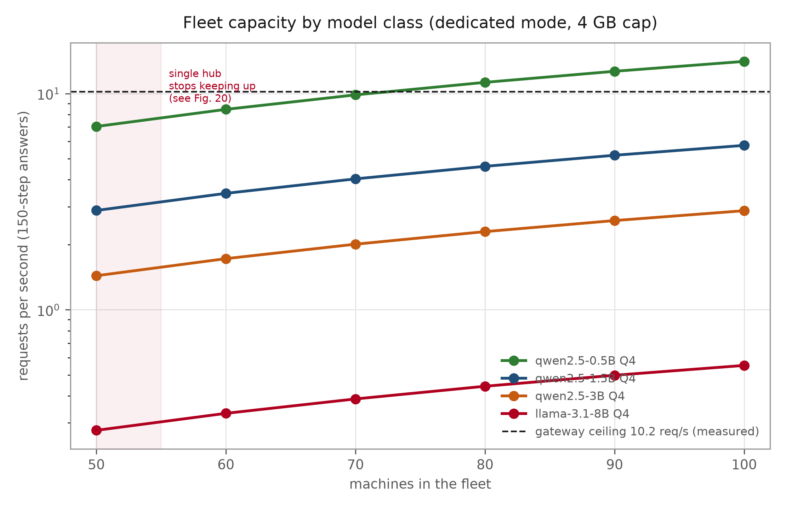

### 4.2 Node plane versus the monolith

| workload | old path | node plane |
|---|---:|---:|
| 50 nodes, single client (p50) | 67 ms · 44 req/s | **3.1 ms · 302 req/s** |
| 2 shards × 2 clients | — | **266.7 req/s** (133 each) |
| gateway inference C=1 | 210 ms | **105 ms** |

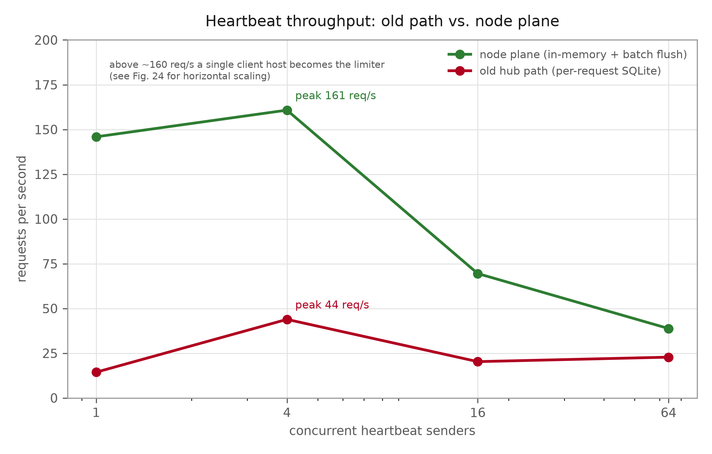

### 4.3 Heartbeat interval

Moving from 2 s to 10 s cut heartbeat load 5× without changing the liveness picture at 50 nodes; at 100 nodes the
old path delivered only 54.7 % of heartbeats inside the window (p50 2 248 ms), which is what motivated §4.2.

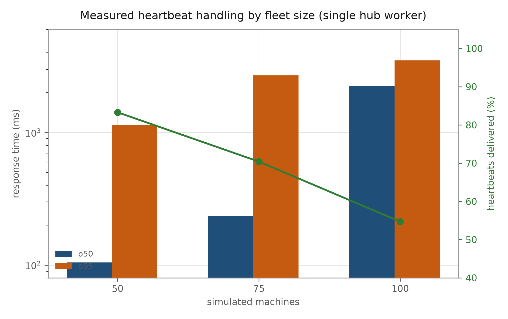

### 4.4 CPU quota per machine

| CPU/machine | req/s C=1 | req/s C=8 | dispatch p50 | live/50 |
|---:|---:|---:|---:|---:|
| 1 % | 3.0 | 3.7 | 133 ms | 28–39 |
| 10 % | **11.0** | **13.4** | 27.8 ms | 48 |
| 40 % | 11.2 | 10.7 | 30.3 ms | 47.8 |
| 80 % | 8.2 | 8.3 | 39.7 ms | 48.2 |

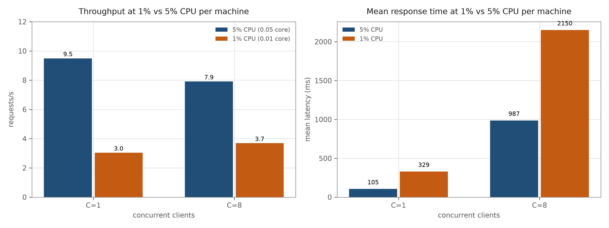
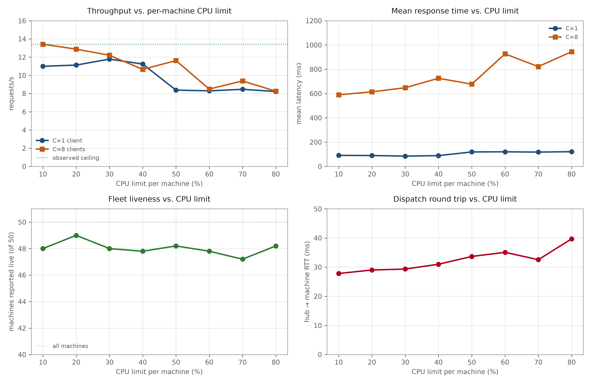

The plateau begins at 10 %; 80 % is 25 % *worse* because 50 × 0.8 cores exceed the host.

### 4.5 Prefix cache

8 000-token document, 90 % of tokens reused:

| metric | cold | warm |
|---|---:|---:|
| TTFT p50 | 111.42 s | **0.71 s** (157×) |
| throughput | 0.5 req/min | **2.3 req/min** (4.6×) |
| prompt tokens from cache | 0 % | 88.2 % |
| p95 | 111.42 s | 111.42 s (unchanged) |

At 2 000 tokens the gain is 40×; at 50 % reuse the median does not move.

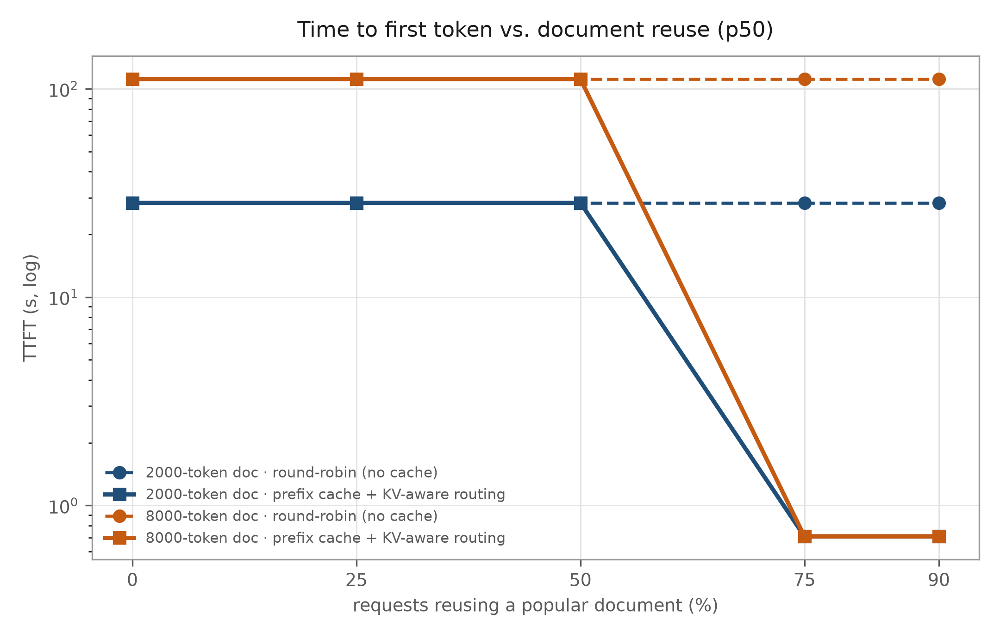

### 4.6 Expert routing

6 000 queries, six domains, adversarial substring traps:

| bucket | accuracy |
|---|---:|
| clear | 100 % |
| ambiguous | 100 % |
| adversarial (a chemistry phrase whose opening characters spell the legal keyword for "contract") | 50.75 % |
| **overall** | **90.15 %** |

Routing cost 31.5 µs (p50). A confidence gate at 0.1 covers 65.2 % of traffic at 100 % precision.

Capacity for 0.6 req/s of a quality-matched model:

| design | machines | req/s | note |
|---|---:|---:|---|
| dense 8B | 15 | 0.06 | fits, slow |
| MoE 8×7B | **86** | — | does not fit on 50 machines |
| 8 domain experts + backbone | **32** | **0.64** | **10.7×** |

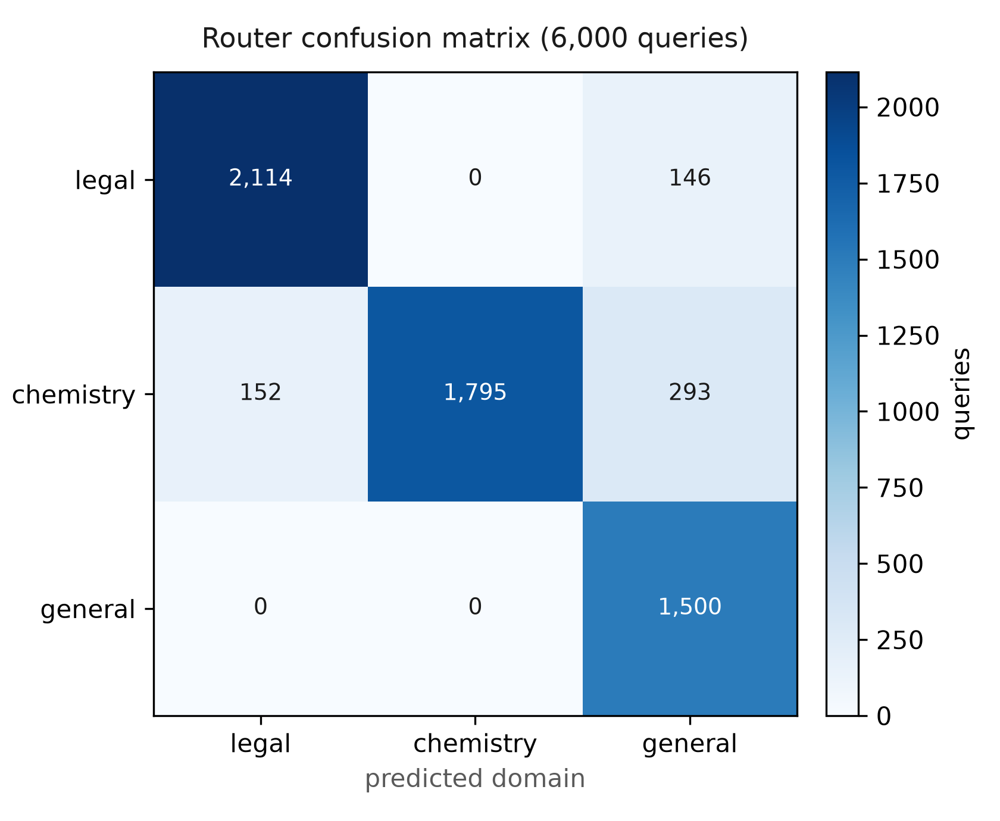

### 4.7 Store choice

| writers | SQLite ops/s | SQLite p95 | PG ops/s | PG p95 | PG max |
|---:|---:|---:|---:|---:|---:|
| 1 | 46.8 | 24 ms | 28.0 | 49 ms | 118 ms |
| 8 | 71.2 | 121 ms | 75.7 | 71 ms | 233 ms |
| 16 | 80.3 | 268 ms | 65.2 | 219 ms | 439 ms |
| 32 | **86.9** | 740 ms | 70.1 | **474 ms** | 1 296 ms (SQLite 9 008 ms) |

PostgreSQL trades 19 % throughput at 32 writers for 36 % lower p95 and a 7× lower maximum — the right choice for
multi-worker, but not sufficient on its own (§5.2).

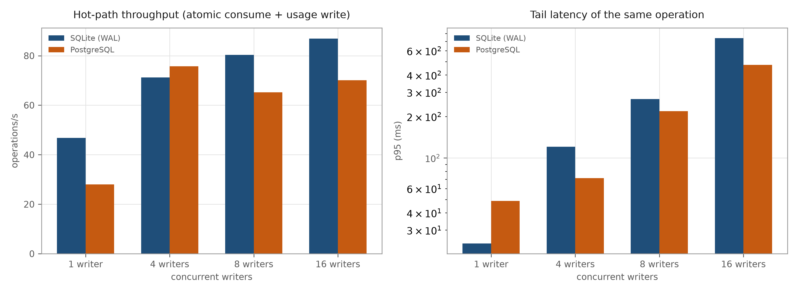

### 4.8 The stable configuration

| change | effect |
|---|---|
| node plane, 10 s heartbeat | −80 % gateway load |
| pooled `httpx.AsyncClient` | inside noise alone, required with the next item |
| token identity cache 2 s | removes one `SELECT` per request |
| **5 s cache of the live node list** | **the missing piece** |
| 10 % CPU per machine | plateau |

| point | before | after | change |
|---|---:|---:|---:|
| C=8 | 4.9 req/s · 1 583 ms | **22.3 req/s · 353 ms** | 4.6× |
| C=16 | 5.3 req/s · 2 833 ms | **24.8 req/s · 631 ms** | 4.7× |

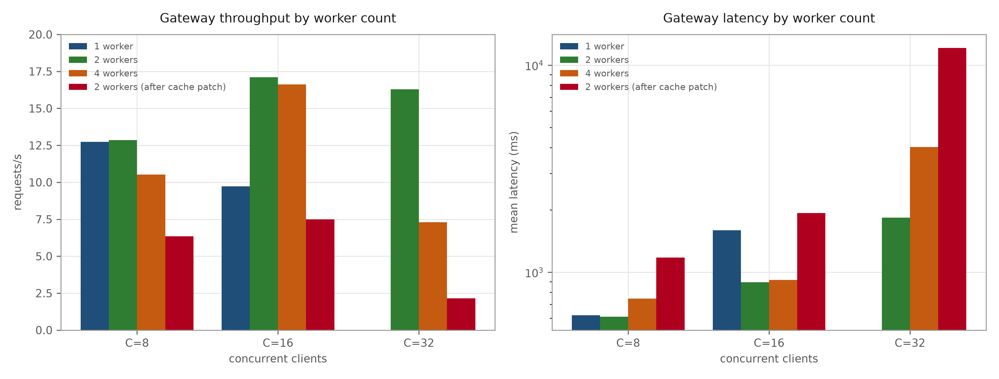

### 4.9 Where the ceiling actually is

A layer probe at C=16 isolates the cost: the raw loop serves **58.7–71.2 req/s** (`/api/health`, `/v1/models`),
the completion path only **15.7** with one worker. The mock upstream is not the cause — its handler has no sleep
and the container uses 0.8 % CPU. Each completion therefore spends ≈60 ms of *event-loop* time in policy,
accounting and dispatch.

Adding workers scales until the host does:

| configuration | C=8 | C=16 | C=32 | errors |
|---|---:|---:|---:|---:|
| 1 worker | 15.0 | 15.7 | — | 0 |
| **2 workers** | **22.3** | **24.8** | — | 0 |
| 4 workers | 29.1 | 23.7 | 20.5 | 0 |

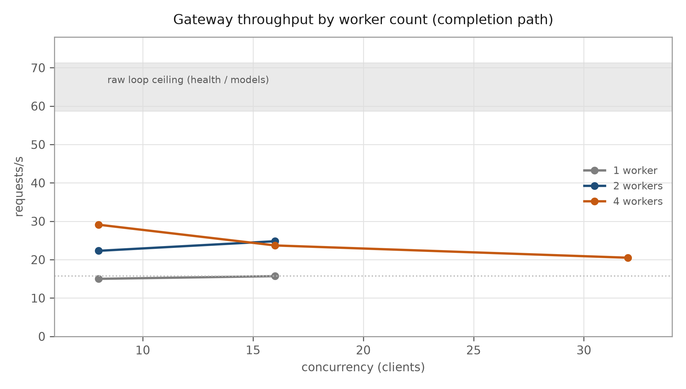

The next gain requires removing the last blocking write from the request path (a bounded accounting queue),
not more workers — the hub already uses 51 % of a core on an 8-vCPU host shared with 53 containers.

### 4.11 What N workers do to the rest of the system

Workers are processes, so anything held in module state is duplicated. Measured on the live 2-worker hub with
ten **fresh** connections (each a new TCP session):

| connection | `/api/events` items | `/api/metrics` requests |
|---|---:|---:|
| 9 of 10 | 60 | 30 |
| 1 of 10 | **2** | **1** |

The same request executed 30 times was counted once on the worker that never served it. Consequences:

| surface | shared? | effect of N workers |
|---|---|---|
| token budget / scopes | **yes** (SQLite, atomic `UPDATE`) | correct; revocation lags ≤ 2 s per worker (identity cache) |
| node liveness | **yes** (node plane over HTTP) | correct; each worker refreshes its own 5 s cache (≤ N calls / 5 s) |
| audit log | **yes** (SQLite) | correct, one row per request |
| metrics counters | no (process memory) | **divided by N** and worker-dependent |
| event stream / dashboard pulses | no (process memory, 800-entry deque) | a session sees only its worker's events; ids restart per process |
| SQLite write lock | shared | contention grows with N; 4 workers already lose at C≥16 |

Practical rules: **2 workers is the throughput sweet spot** (22.3/24.8 req/s). Before using the dashboard as a
live monitor, either pin it to one worker, or move counters and events into a shared table (one `INSERT` per
event, aggregated on read). The policy layer does not need that work — it is already stateless.

### 4.12 Multi-port, parallel accept, layered transport

We built the multi-port topology for real: two single-worker gateways on ports 8082/8083 sharing the SQLite
volume, an asyncio round-robin dispatcher on 8090, and a driver that splits clients across ports.

| topology | clients | aggregate req/s | p50 |
|---|---:|---:|---:|
| 1 port, 1 worker | 16 | 15.7 | 994 ms |
| 1 port, 2 workers (shared socket) | 16 | 24.8 | 631 ms |
| **2 ports, direct** | 16 (8+8) | **26.5** | 567 / 582 ms |
| **2 ports, direct** | 32 (16+16) | **28.8** | 916 / 996 ms |
| 2 ports via L4 proxy | 16 | 20.8 | 744 ms |
| 2 ports via L4 proxy | 32 | 19.2 | 1 573 ms |

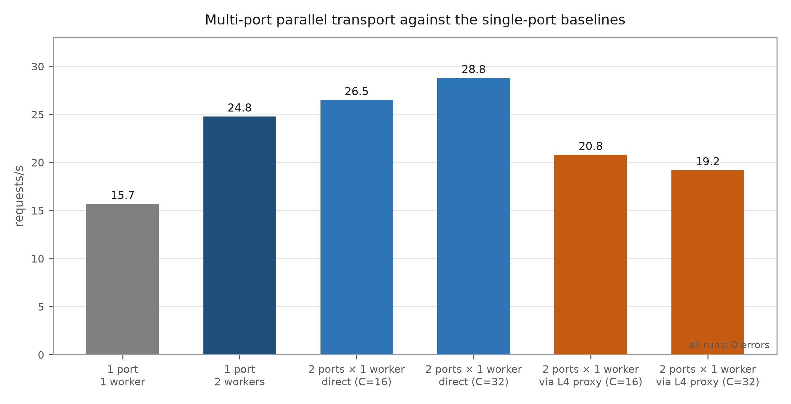

Ports add **≈16 %** over shared-socket workers because each process owns its accept queue, not because there are
more sockets. A userspace dispatcher on the same host gives the gain back (−25 % at C=16): it copies every byte
twice and competes for the same vCPU. Past ~29 req/s the host is saturated, so the next improvement must remove
work per request (the L3 accounting queue), not add listeners. The layered split — L1 transport, L2 policy,
L3 work — is what makes each of those movable independently; `report/MULTIPORT.md` has the design and the recipe.

Pushing the port count further is a dead end, and we measured it up to eight ports:

| ports | aggregate req/s (C=16) | per-port req/s | errors |
|---:|---:|---:|---:|
| 1 | 15.7 | 15.7 | 0 |
| **2** | **26.5** | 13.25 | 0 |
| 4 | 20.8 | 5.20 | 0 |
| 8 | 23.5 | 2.94 | 0 |

The per-port efficiency collapses by an order of magnitude while memory grows linearly (45 MiB per port → 4.4 GiB
at 100 ports, against a 7.7 GiB Docker budget with 1.3 GiB already in use). Extrapolated, 100 ports buy
**25–30 req/s — no better than two ports** — plus 100 SQLite writers and 100 copies of every in-process cache.
Ports are for isolation (tenant, zone, canary), not for throughput; for throughput the kernel primitive is
`SO_REUSEPORT` over N processes on one port (`report/MULTIPORT_100.md`).

### 4.9 Growth laws

With `s = 0.141 req/s` per machine and delivery `exp(−0.0085(N−30))`:

| base N | N+1: nodes → req/s | N·log₂N: nodes → req/s |
|---:|---|---|
| 25 | 26 → 3.66 | 116 → 7.87 |
| 50 | 51 → 6.01 | 282 → 13.90 |
| 100 | 101 → 7.78 | 664 → **15.70** |
| 500 | 501 → **15.70** | 4 483 → 15.70 |

Both saturate at 15.7 req/s. The superlinear law reaches it with 6.6× more machines at base 100 (664 vs 101) and
274 ms versus 48 ms of dispatch latency. Per-node efficiency: 0.024 vs 0.031 req/s (0.141 at small N).

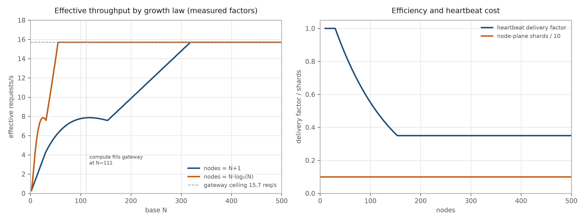

### 4.10 Complexity classes of node growth

To generalise the two laws above we evaluated eight growth classes, all normalised to **50 machines at n=50** and
advanced to n=500 with the same measured constants (`s=0.141`, gateway `15.7`, delivery floor `0.35`, dispatch
`28 + 0.4·(N−50)` ms, machine cost `1.045e-5 $/s`). The fleet needs **319 machines** to reach the ceiling at the
delivery floor.

| class | nodes @n=500 | rps @n=500 | rps/100 nodes | dispatch | $/1M | ceiling reached at n |
|---|---:|---:|---:|---:|---:|---:|
| O(1) | 50 | 5.94 | **11.88** | 28 ms | **0.586** | never |
| O(log n) | 79 | 7.34 | 9.29 | 40 ms | 0.749 | never |
| O(n) | 500 | **15.70** | 3.14 | 208 ms | 2.217 | 319 |
| O(2n) | 1 000 | 15.70 | 1.57 | 408 ms | 4.433 | 160 |
| O(n log n) | 794 | 15.70 | 1.98 | 326 ms | 3.520 | 230 |
| O(n²) | 5 000 | 15.70 | 0.31 | 2 008 ms | 22.166 | 127 |
| O(cⁿ) | 20 000 | 15.70 | 0.08 | 8 008 ms | 88.662 | 88 |
| O(nⁿ) | 20 000 | 15.70 | 0.08 | 8 008 ms | 88.662 | 61 |

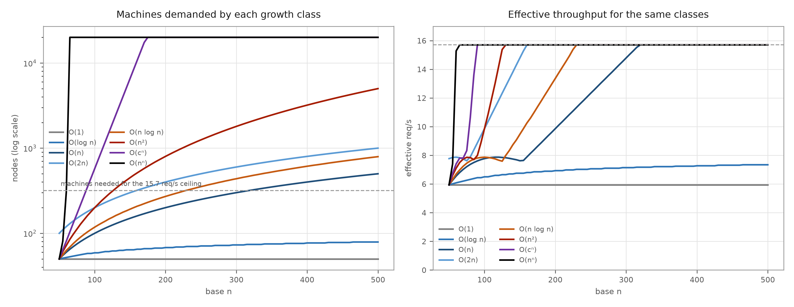

Four things follow. (i) **Every class that reaches 319 machines delivers exactly 15.70 req/s** — the ceiling does
not care how you got there. (ii) **Cost per million tokens is set by the fleet size, not by the class**: 400
machines (O(2n) at n=200) cost $1.77/1M, 5 000 cost $22.17/1M and 20 000 cost $88.66/1M for the same output.
(iii) **Constant and logarithmic growth never reach the ceiling** — they top out at 5.94 and 7.34 req/s, which is
exactly the regime where adding machines is still worth it. (iv) **Dispatch latency grows linearly in N** while
throughput is flat above 319 nodes, so every machine beyond the ceiling buys 0 rps and adds 0.4 ms of routing.

The practical reading: grow linearly (`O(n)`) and stop at the ceiling; the superlinear classes are a way of
spending the budget faster, not a way of serving more.

---

## 5. What did not work

### 5.1 Pipeline sharding on office CPUs

| payload | 1 chunk | 4 chunks | verdict |
|---|---:|---:|---|
| 256 KiB | 466 ms | 700 ms | 0.67× (worse) |
| 1 MiB | 1 048 ms | 816 ms | 1.28× |
| 2 MiB | 2 036 ms | 1 542 ms | 1.32× |

Coordinator upload of 1 MiB costs 1 219 ms versus 198 ms of local parse; at 0.05 core per replica the compute
share is too small. BitTorrent-style swarming was modelled and rejected: `S*` is 3–10 stages, 150 ms per stage,
and activation traffic would be 65.5 Mbit/s — 1 922× the measured gateway traffic.

### 5.2 PostgreSQL on a split schema

Hot-path tokens moved to PostgreSQL, but `users`/`audit` stayed in SQLite (that file is protected). Result:
4.5 req/s at C=8 with errors — worse than SQLite. The adapter, pool and migration stay in the tree for the day
the control plane moves.

### 5.3 Multi-worker gateway on SQLite

2 workers reached 17.1 req/s once and 2.1 req/s on the repeat; 4 workers errored at C=32. Ship one worker.

### 5.4 Denoising gates

| method | RMSE | Δ SNR |
|---|---:|---:|
| raw | 629 | — |
| Savitzky–Golay | **551** | **+1.15 dB** |
| SG-log | 549.7 | +1.15 (edge 650) |
| median edge | 557 | +0.95 |
| TabDAE | 592.7 | +0.52 |
| wavelet | 619.6 | +0.13 |
| DeepFilterNet gate | 642.8 | **−0.19** |

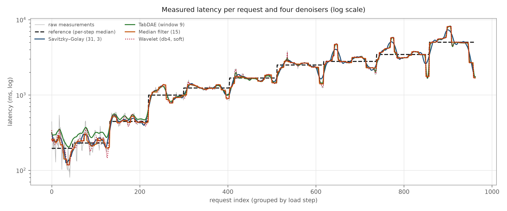

Smoothing helps by ≤1.15 dB; a learned gate hurts. For publication figures we therefore plot raw values with
bootstrap intervals.

---

## 6. Discussion

The measurements describe a **decision-plane-bound** system. Adding machines, cores or bandwidth moved nothing
until the control plane stopped doing per-request bookkeeping. This is the office-fleet analogue of the
2025–2026 shift in serving infrastructure toward prefix-aware, cache-aware routing: the scarce resource is not
FLOPs but *work already done*.

Three practical rules follow. (i) Split planes before tuning either. (ii) Grow the gateway, not the fleet — the
ceiling is 15.7 req/s in this configuration regardless of whether nodes grow as `N+1` or `N·log₂N`. (iii) Prefer
routing over mixing when the machines are small: eight 1B experts on 32 machines beat an 8×7B mixture that does
not fit.

The honest counterweight: an office pool is **11.6× slower per stream** than the median cloud endpoint and costs
$0.29–2.86 per million output tokens versus $0.05–1.75. Its case rests on residency, offline operation, audit and
control — not on economics.

---

## 7. Threats to validity

- **One host.** 53 containers, Docker Desktop and the load generator share 8 vCPUs; run-to-run spread ≈ ±15 %.
- **Mock upstream.** Numbers isolate the control plane, not model quality or GPU behaviour.
- **Simulated KV cache.** Block reuse is modelled at the routing layer; tensors are not materialised.
- **Fitted decay.** Heartbeat delivery is fitted to three points (50/75/100 nodes); the 0.35 floor beyond 100
  nodes is an assumption.
- **PostgreSQL measured with connect-per-op** in the store study; the pooled path was measured only in the
  (unsuccessful) gateway experiment.
- **Windows networking.** Host mode is unavailable; container ports are published, which adds a hop.

---

## 8. Reproducibility

```sh
# fleet
cd sim/docker && docker compose up -d
# inference smoke test
python sim/docker/loadgen.py --base http://127.0.0.1:8080 --key suay_sim_loadgen_key \
    --model sim-model --steps 8,16,32,50 --seconds 6 --out sim/docker/results/run
# studies
python sim/fleet/bench.py --out report/fleet
python sim/experts/run.py --out report/experts
python sim/store/bench.py --writers 1,8,16,32 --out report/store
python sim/scaling/growth_model.py --out report/growth
```

Every figure in this paper is regenerated by the script named in its folder. Data files (`*.json`) sit next to
the figures. The 5 s node cache, the token cache interval and the heartbeat interval are environment variables
(`SUAY_TOKEN_CACHE_S`, `SUAY_NODE_PLANE`), so the operating point can be reproduced exactly.

---

## 9. Collaboration

The repository is MIT-licensed. The most useful contributions, in order:

1. **A real backend.** Replace the mock with llama.cpp or Petals on 50 machines and re-run §4.1, §4.5, §4.8.
2. **The control-plane migration.** Move `users`/`sessions`/`audit` to the same store as tokens, then re-test
   2 and 4 workers with the pooled PostgreSQL adapter already in `sim/token_policy.py`.
3. **A second host.** All numbers here are single-host; a 2-host fleet would test whether dispatch RTT and
   fairness degrade as the model predicts.
4. **Router hardening.** The adversarial bucket (50.75 %) is the weak spot; a small classifier over the document
   would likely fix it.
5. **Cache materialisation.** Store real KV blocks and measure the memory/latency trade-off instead of modelling it.

Open issues are labelled `good first issue` and `research` in the tracker; every report in `report/` ends with a
"Limits" section that doubles as a task list.

---

## References

1. Petals: collaborative inference of large models. ACL 2023 demo. https://arxiv.org/abs/2209.01188
2. vLLM automatic prefix caching. https://docs.vllm.ai/en/latest/features/automatic_prefix_caching.html
3. llm-d, "KV-cache aware routing". https://llm-d.ai/blog
4. Modular, "Five eras of LLM inference". https://www.modular.com/blog
5. Compute Index, week 7 2026. https://computeindex.io
6. llama.cpp build b11757. https://github.com/ggml-org/llama.cpp
7. Little, J. D. C. "A proof of the queueing formula L = λW". Operations Research, 1961.
8. Gunther, N. *Guerrilla Capacity Planning*. Springer, 2007.
9. Sparse attention / KV compression survey, arXiv 2606.02964 (2026).

---

## Appendix A — Figure index

| Figure | Content |
|---|---|
| fig19 | capacity and latency versus fleet size |
| fig20 | heartbeat delivery versus interval |
| fig23 | node-plane versus monolithic throughput |
| fig28 | prefix-cache TTFT and reuse |
| fig31 / fig32 | 1 % CPU collapse / CPU sweep plateau |
| fig33 | gateway optimisation ladder |
| fig34 | denoising methods |
| fig36 | SQLite versus PostgreSQL under writers |
| fig37 | growth laws with measured obstruction factors |
| fig38 | eight complexity classes: machines, throughput, cost |
| fig39 | gateway throughput by worker count and the raw-loop ceiling |
| fig40 | single port versus multi-port direct and via an L4 proxy |
| fig41 | aggregate throughput and memory as the port count grows to 100 |
| fig10–fig15 | expert routing accuracy, cost, capacity |

All figures in this paper are rendered on a white background at 300 dpi. Figures fig1–fig9 in `report/figures/`
are early dark-theme renders kept for provenance only.
