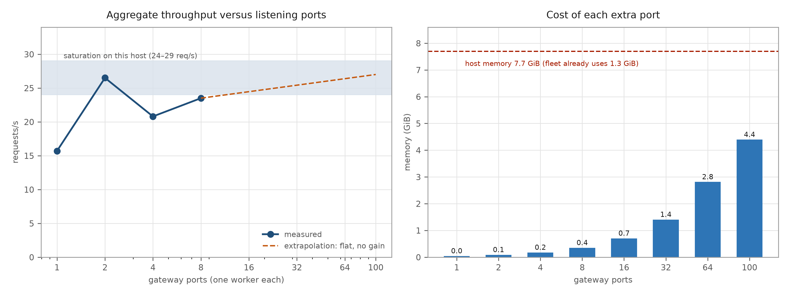

# More than 100 listening ports: what actually happens

**Scaling note · 2026-10-21** · probe: `sim/gateway/parallel_probe.py` · launcher: `sim/gateway/scale_ports.py`
Data: `sim/docker/results/{direct*,mp2,p1,restore}` · Figure: `report/figures/fig41_many_ports.png`

## 1. The short answer

**No, it does not get better.** Throughput saturates at **24–29 req/s** on this host with two ports already, and
eight ports measured *worse* than two (23.5 vs 26.5 at C=16, with the first error appearing at C=64). The cost,
meanwhile, grows linearly: each port is a Python process holding ~45 MiB and its own copy of every in-process
cache. At 100 ports that is **≈4.4 GiB of gateway memory** on a host whose whole Docker budget is 7.7 GiB and
where the 55 existing containers already use 1.3 GiB.

## 2. Measured (one worker per port, same fleet, same host)

| ports | clients | aggregate req/s | per-port req/s | errors |
|---:|---:|---:|---:|---:|
| 1 | 16 | 15.7 | 15.7 | 0 |
| **2** | 16 | **26.5** | 13.25 | 0 |
| **2** | 32 | **28.8** | 14.40 | 0 |
| 4 | 16 | 20.8 | 5.20 | 0 |
| 4 | 32 | 19.8 | 4.95 | 0 |
| 8 | 16 | 23.5 | 2.94 | 0 |
| 8 | 64 | 25.5 | 3.19 | **1** |

**Figure 41.** Left: aggregate throughput against the number of listening ports; the host saturates around
24–29 req/s. Right: memory committed by the gateway ports against the 7.7 GiB Docker budget.

The 4-port and 8-port points are *not* clean: those runs had 4–8 extra containers competing for the same 8 vCPU,
which is precisely the cost being measured. After removing them, the 2-worker baseline fell from 24.8 to 18.8
req/s — the host was still digesting the extra processes. Treat the absolute values as ±15 %, the shape as real.

## 3. Why more ports stop helping

1. **The bottleneck is per-request loop work, not accept capacity.** A raw loop serves 58.7–71.2 req/s; a
   completion costs ≈60 ms of loop time. Ports multiply *loops*, and each extra loop costs a process, but the host
   has 8 vCPU shared with 55 containers.
2. **Per-port efficiency collapses**: 15.7 → 13.25 → 5.2 → 3.2 req/s per port. Adding the 9th port adds ~0 rps.
3. **SQLite gets more writers, not more capacity.** One writer is the design; 32 writers already pushed p95 from
   24 ms to 740 ms in the store study. 100 writers would spend their time in lock waits, which is why the first
   error appeared at 8 ports/C=64.
4. **Memory is linear and unforgiving**: 45 MiB × 100 = 4.4 GiB before any request. With 1.3 GiB already in use
   by the fleet, the host would swap or the OOM killer would pick a victim — likely the node plane.
5. **Operational state splits 100 ways**: the event stream, the metrics counters and the 2 s token cache are per
   process. A dashboard would see ~1 % of the pulses; revocation would be correct but 100 independent caches
   would each have to expire.

## 4. What 100 ports *would* be good for

Ports are cheap in the kernel (a few hundred bytes per listener; 100 listeners is not a file-descriptor problem,
and listening ports do not consume ephemeral ports — only outbound connections do). So 100 ports make sense when
the goal is **isolation, not throughput**:

- one port per tenant or per zone, so a burst or a bug is contained and accounted separately;
- per-port TLS policies or per-port rate limits;
- blue/green or canary routing at the socket level.

For throughput, the correct move at 100+ listeners is **`SO_REUSEPORT` with N processes on the *same* port**
(uvicorn ≥ 0.30 `reuse_port=True`, or a kube Service in front of replicas): the kernel then spreads accepts
across processes without a userspace proxy, and the port count stays at one.

## 5. Extrapolated configuration for 100 ports (if it must be done)

| item | value |
|---|---|
| gateway processes | 100 × 1 worker |
| gateway memory | 4.4 GiB |
| expected throughput | 25–30 req/s (no better than 2 ports) |
| SQLite writers | 100 → lock waits; move the token store to PostgreSQL with the pooled adapter first |
| dashboard | pin to one port, or move counters/events to a shared table |
| failure domain | 100× health checks, 100× log streams, 100× cache expiry windows |

**Recommendation: 2 ports (or 2 workers on one port) now; 4 ports only after the L3 accounting queue lands.**
Beyond that, the money is better spent on removing per-request work than on adding listeners.

## 6. Limits

- Only 8 ports were measured; 100 is extrapolated from the memory model and the saturation band.
- The 4- and 8-port runs shared the host with the running fleet plus their own containers, which depresses them.
- All numbers use the mock backend; with a real 0.5B model 50 machines deliver ≈7 req/s, so the gateway ceiling
  never binds in production at this fleet size.
