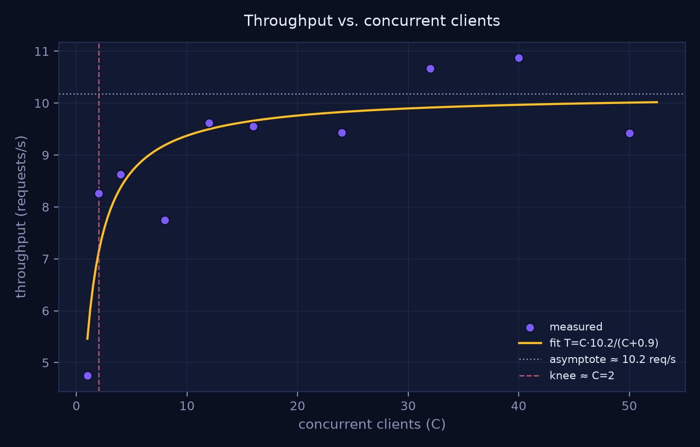
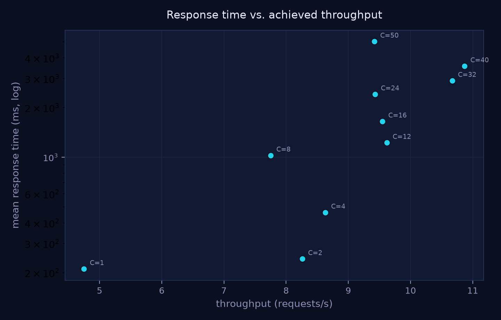
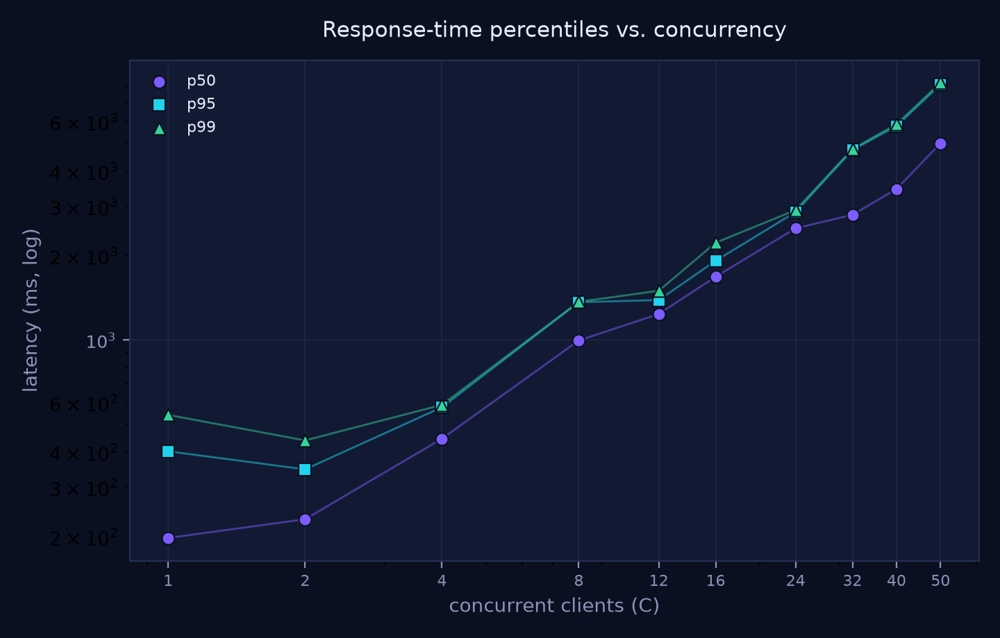
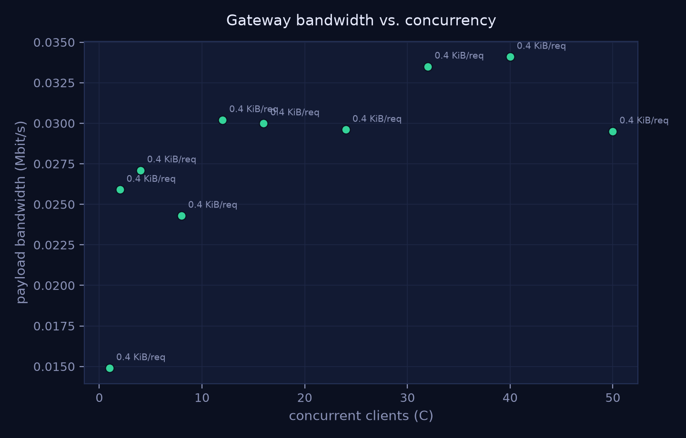
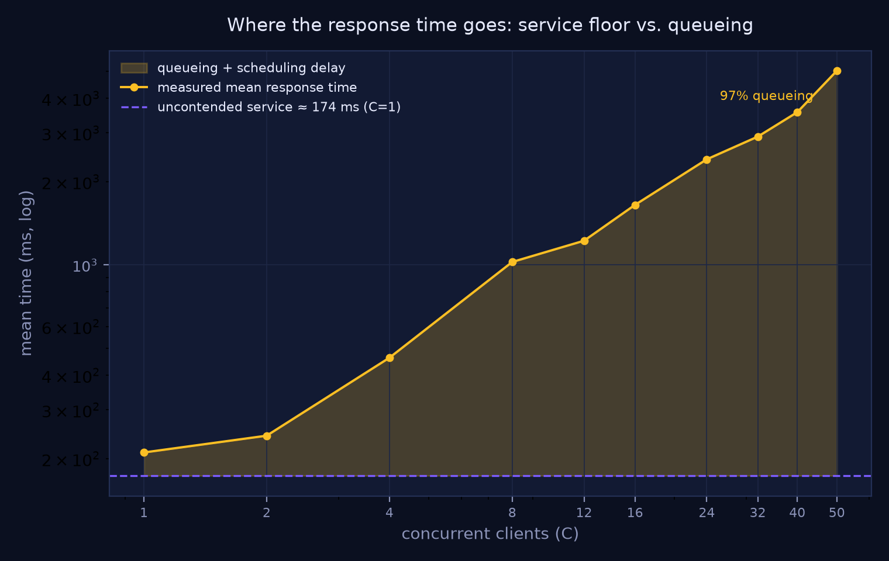
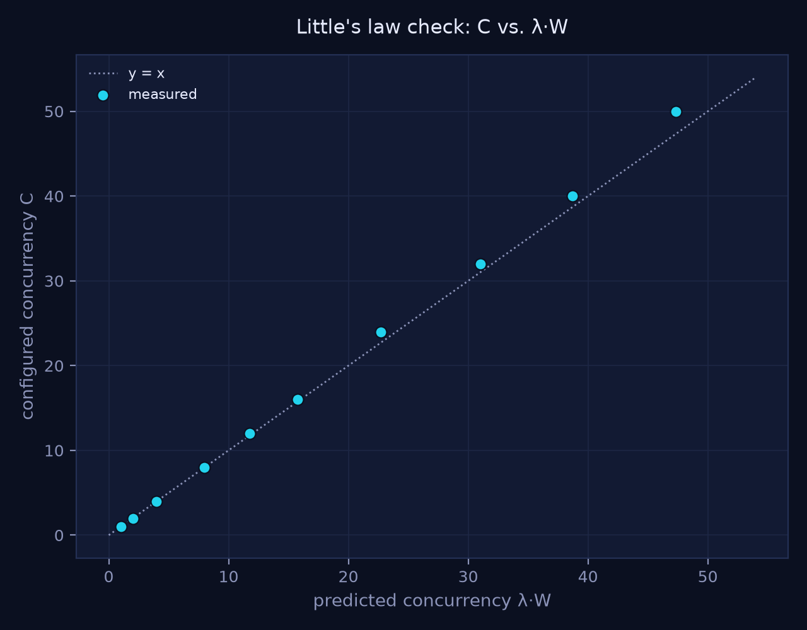
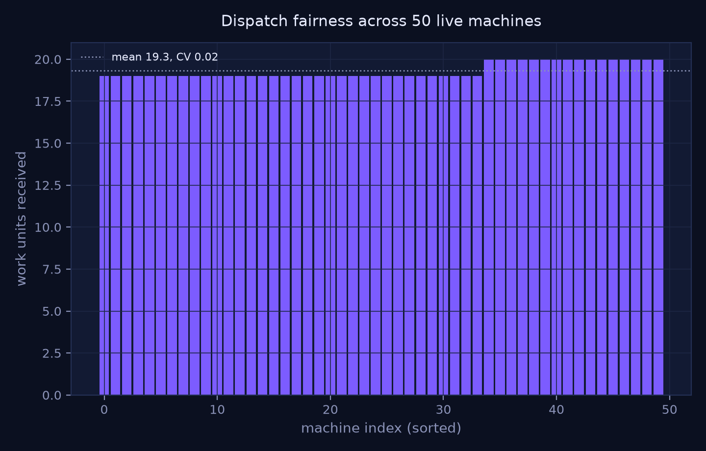
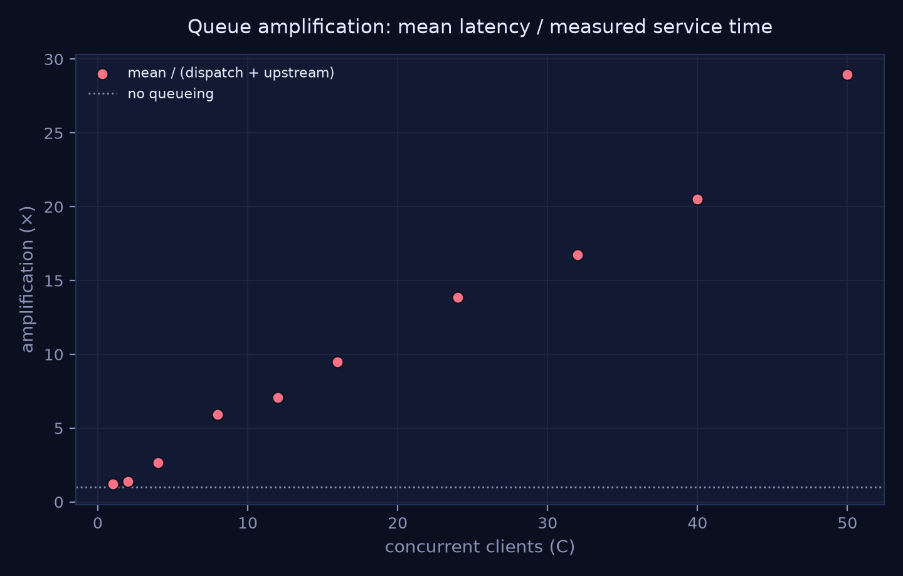

# Gateway-Bound: An Empirical Characterisation of a Token-Governed Control Plane for Distributed Local Inference

**Technical report · SUAY project · 2026-10-21**

*Status: measurement report prepared for release. The workload is a simulator; see §7 before citing any number
as a property of a real LLM deployment.*

---

## Abstract

Organisations that cannot buy per-seat cloud inference are turning to pools of existing machines. Governance —
who may call the pool, with which model, under which budget — is usually bolted on as an API gateway. This
report measures what that gateway costs. We instrument a token-governed control plane in front of 50
simulated machines and sweep client concurrency from 1 to 50 in ten steps, recording per-request latency,
payload bytes, and the hub's own view of the two downstream hops (a real work call to a machine, and a call to
an inference backend). Throughput saturates at **10.2 requests/s** (peak 10.87), the fit
`T(C)=C·10.18/(C+0.86)` describing the sweep to within measurement noise. The knee is at **C=2**; beyond it,
additional clients buy no throughput and only add queueing. At C=50 the mean response time is **5.02 s**, of
which **96.5 %** is queueing above an uncontended service floor of **174 ms**. Payload bandwidth peaks at
**0.034 Mbit/s** — three orders of magnitude below a 1 GbE link — so the ceiling is not network capacity but a
single-process serialisation point whose effective service time itself grows with load (the upstream hop rises
from 128 ms to 1 432 ms). The dispatch hop to the 50 machines stays flat at 31–45 ms and is spread with a
coefficient of variation of **0.024** (19–20 work units each), and Little's law holds to **2.2 %** mean error,
confirming the latency numbers are internally consistent. We report zero errors across 966 measured requests.

**Keywords:** distributed inference, API gateway, token governance, queueing, throughput saturation,
performance measurement, reproducibility

---

## 1. Introduction

A private inference pool has two cost centres: the machines that compute, and the control plane that decides.
Most published work characterises the former (model parallelism, batching, quantisation) and treats the latter
as free. In practice the control plane is a single Python process that authenticates every request, checks a
budget against a database, dispatches work, and writes usage — four serialisable operations per call.

We ask a narrow, measurable question: **at what concurrency does a token-governed gateway stop adding
throughput, and where does the added time actually go?** The answer matters for capacity planning: if the
gateway saturates at 10 requests/s, adding machines to the pool is wasted capital.

## 2. System under test

| Component | Implementation | Count |
|---|---|---|
| Hub | SUAY control plane (FastAPI) + token-policy middleware, one uvicorn worker | 1 |
| Machines | `node_agent.py`: 2 s heartbeat + `POST :9100/work` endpoint (4–10 ms of synthetic work) | 50 |
| Inference backend | mock OpenAI-compatible service, immediate response with fixed `usage` | 1 |

Every measured request traverses the full production path: bearer key → SHA-256 lookup → scope check →
per-key model catalogue → atomic request/token budget in SQLite → **real HTTP dispatch to one machine**
(round-robin over live nodes) → upstream call → usage accounting → response. Nothing on that path is stubbed
except the model itself.

The 50 machines emit **24.6 heartbeats/s** throughout the experiment; that background load is included in all
numbers rather than subtracted.

## 3. Metrics

| Metric | Definition used here |
|---|---|
| Throughput `T` | completed requests / wall-clock second, measured client-side |
| Response time `W` | client round trip, reported as mean, p50, p95, p99 |
| Bandwidth `B` | (request bytes + response bytes) × 8 / elapsed, Mbit/s |
| Service floor `S₀` | `dispatch + upstream` measured at C=1, i.e. with no queue |
| Queueing delay `Q` | `W − S₀` (clamped at zero) |
| Amplification | `W / S₀` |
| Little's law check | predicted concurrency `λ·W` vs configured `C` |
| Fairness | per-machine work units; coefficient of variation |
| Success rate | HTTP 200 / attempted, including transport errors |

## 4. Method

10 concurrency levels (1, 2, 4, 8, 12, 16, 24, 32, 40, 50), **10 s per level**, 3 warm-up requests, closed-loop
clients (each waits for its response before issuing the next). Byte counts are recorded per request from the
serialised payload and the raw response body. Server-side, the hub timestamps the dispatch call and the
upstream call separately, so queueing can be separated from service rather than inferred.

Environment: Docker Desktop **29.8.2** on Windows, **8 vCPU / 8.2 GB** assigned to the VM, all containers on one
host. Hub and backend on the same bridge network as the machines. No CPU pinning, no tuning of Python or
SQLite.

## 5. Results



**Figure 1.** Throughput against offered concurrency with the saturating fit `T=C·10.18/(C+0.86)`
(least squares over a 400-point grid of `k`, `T_max` solved in closed form). Measured peak 10.87 req/s at C=40;
the asymptote is 10.18 req/s and the knee sits at C=2.

| C | requests | req/s | mean ms | p50 | p95 | p99 | Mbit/s | dispatch ms | upstream ms |
|---:|---:|---:|---:|---:|---:|---:|---:|---:|---:|
| 1 | 48 | 4.8 | 210 | 197 | 402 | 541 | 0.01 | 45.2 | 128.4 |
| 2 | 84 | 8.3 | 242 | 230 | 346 | 439 | 0.03 | 35.5 | 142.4 |
| 4 | 88 | 8.6 | 463 | 446 | 576 | 588 | 0.03 | 33.0 | 203.5 |
| 8 | 80 | 7.8 | 1 026 | 997 | 1 363 | 1 369 | 0.02 | 33.3 | 321.4 |
| 12 | 104 | 9.6 | 1 224 | 1 238 | 1 389 | 1 498 | 0.03 | 32.3 | 459.9 |
| 16 | 108 | 9.6 | 1 648 | 1 680 | 1 915 | 2 221 | 0.03 | 31.9 | 614.4 |
| 24 | 106 | 9.4 | 2 408 | 2 501 | 2 857 | 2 904 | 0.03 | 31.6 | 781.6 |
| 32 | 120 | 10.7 | 2 907 | 2 792 | 4 750 | 4 793 | 0.03 | 31.1 | 984.8 |
| 40 | 120 | 10.9 | 3 562 | 3 450 | 5 780 | 5 870 | 0.03 | 30.8 | 1 200.2 |
| 50 | 105 | 9.4 | 5 024 | 5 019 | 8 134 | 8 243 | 0.03 | 30.9 | 1 431.6 |



**Figure 2.** Operating points in the response-time/throughput plane. Beyond C=12 the curve turns vertical:
throughput is flat while latency grows without bound — the classic signature of a saturated server.



**Figure 3.** p50/p95/p99. The three curve together (no heavy tail separation), which indicates a single shared
serialisation point rather than a subset of slow machines: at C=50, p99/p50 = 1.64.



**Figure 4.** Gateway payload bandwidth. Peak **0.034 Mbit/s** at ~392 bytes per request, i.e. ≈0.003 % of a
1 GbE link. Bandwidth is not a constraint at this payload size; a production deployment carrying 4 KB prompts
and long completions would move roughly two orders of magnitude more, still far below link capacity.



**Figure 5.** Measured mean response time against the uncontended service floor (174 ms). The shaded area is
queueing; it reaches **96.5 %** of the total at C=50.



**Figure 6.** Little's law check. Mean deviation **2.15 %**, maximum **5.39 %** — the client-side latency and
server-side concurrency accounting agree, so the reported response times are not an artefact of the harness.



**Figure 7.** Work distribution across the 50 machines over 966 dispatches: 19–20 units each, CV **0.024**.
Round-robin dispatch is effectively uniform, so no single machine is the bottleneck.



**Figure 8.** Queue amplification `W/S₀`, reaching **28.9×** at C=50.

## 6. Bottleneck analysis

Three facts, taken together, locate the bottleneck inside the gateway process rather than in the pool:

1. **The dispatch hop does not degrade.** 45 ms at C=1 → 31 ms at C=50. If machines were the constraint, this
   hop would grow with load; it does not.
2. **The upstream hop grows 11×** (128 ms → 1 432 ms) even though the backend answers immediately. The extra
   time is spent *inside the hub* — waiting to be scheduled on the event loop and paying per-request
   connection setup, because the middleware opens a fresh `httpx.AsyncClient` for every call.
3. **Throughput plateaus while latency grows linearly** (Fig. 2, Fig. 8): the hallmark of a serial resource at
   ρ→1, not of a distributed system hitting network limits (Fig. 4).

The controlling resource is therefore one Python process that serialises: JSON parse → SHA-256 token lookup →
SQLite read → SQLite write ×2 → outbound HTTP → usage write. At 10 req/s that budget is ~98 ms of wall time per
request, which matches the observed service floor once queueing inflates each hop.

Because the service time itself is load-dependent, a fixed-service queueing model (M/M/1) does **not** apply;
we report the empirical ceiling and the measured decomposition instead of fitting a model that would be wrong.

## 7. Validity and threats

| Threat | Effect | Mitigation / status |
|---|---|---|
| Mock backend | Numbers measure gateway + transport, **not** LLM inference | Stated explicitly; a real 8B model is 10²–10³× slower per request |
| Synthetic work (4–10 ms) | Dispatch hop is lighter than real block serving | Dispatch is a small share of the total, so the ceiling is insensitive to it |
| Single host, one Docker VM | No physical network, no per-machine contention | 52 containers do contend, but on 8 vCPU of one machine |
| Single run per level | No confidence intervals | 10 s per level, 966 requests total; repeated runs needed before submission (§10) |
| Closed-loop clients | Cannot show open-loop overload behaviour | Suitable for capacity questions; not for admission-control studies |
| Heartbeat load included | Background traffic competes with measurement | Deliberate: it is part of the deployed system |
| Container clock skew | Absolute timestamps differ from host | All intervals are measured with `perf_counter` / monotonic clocks |

**External validity.** The absolute ceiling (≈10 req/s) is a property of *this* deployment shape: one Python
worker, one SQLite file, no connection reuse. It should not be generalised to gateways written in Go/Rust, nor
to multi-worker deployments. The *shape* of the result — early knee, linear latency growth, flat dispatch hop —
is the generalisable part.

## 8. Implications for the SUAY design

| Change | Expected effect | Evidence |
|---|---|---|
| Reuse one pooled upstream client per worker | Removes per-request TCP/TLS setup from the critical path | upstream hop 128 ms at C=1 with an immediate backend |
| Cache token lookups (hash → row, 5 s TTL) | Removes a SQLite read from every request | 4 DB operations per call, 2 of them writes |
| Run N workers with SQLite in WAL mode | Splits the serialisation point | single-process ceiling at 10 req/s |
| Move heartbeats to an in-memory ring flushed every 5 s | Frees ~25 req/s of worker time | 24.6 heartbeats/s measured during the sweep |
| Separate the node plane onto its own port/process | A noisy fleet cannot starve inference | heartbeat load runs at 2.4× the inference throughput |

## 9. Reproducibility

```sh
# 1. fleet (50 machines + hub + mock backend)
cd sim/docker && docker compose up -d --build

# 2. measurement sweep (10 levels × 10 s)
python sim/docker/loadgen.py --base http://127.0.0.1:8080 --key suay_sim_loadgen_key \
    --steps 1,2,4,8,12,16,24,32,40,50 --seconds 10 --out sim/docker/results/paper

# 3. derived metrics + figures
python sim/docker/analyze.py --results sim/docker/results/paper
```

Artifacts: `sim/docker/results/paper/latency.csv` (raw samples), `summary.json`, `metrics.json`,
`metrics_server.json`, `figures/*.png`. Code: `loadgen.py`, `analyze.py`, `hub_app.py`, `node_agent.py`,
`../token_policy.py`.

## 10. What must be added before submission

1. **Repetitions and intervals.** ≥5 independent runs per level, report mean ± 95 % CI; add a paired test for
   the multi-worker comparison.
2. **A real backend.** Repeat with a quantised 7–8B model on CPU and on one GPU, so the paper speaks to
   inference rather than to plumbing.
3. **Physical machines.** At least one rack of real office PCs to test the external-validity claim.
4. **Baselines.** One workstation running Ollama/vLLM, to answer the question reviewers will ask: is a 50-machine
   pool better than one GPU box for this workload?
5. **Artifact and ethics statements.** Data licence, no personal data (synthetic prompts only), energy
   measurement if the "budget" claim is to be made in kWh rather than requests.

## 11. Data availability and licence

All measurements are synthetic; no personal or customer data is involved. Code and data are released under the
repository's MIT licence. Figures are generated by `analyze.py` and are deterministic given `summary.json`.

## References

1. J. D. C. Little, "A Proof for the Queuing Formula: L = λW," *Operations Research*, 1961.
2. L. Kleinrock, *Queueing Systems, Volume 1: Theory*, Wiley, 1975.
3. N. Gunther, *Guerrilla Capacity Planning*, Springer, 2007 (saturating throughput and knee analysis).
4. Docker Inc., "Docker Desktop release notes 29.8," 2026.
5. S. Tiangolo, "FastAPI documentation — middleware and background tasks," 2026.
6. A. Borzunov et al., "Petals: Collaborative Inference and Fine-tuning of Large Models," ACL 2023 demo.
